# Tesla Dashcam Studio

### ▶ Use it now: **https://shinrajp.github.io/dashcam-studio/**

A Tesla dashcam and Sentry viewer that runs entirely in your browser. Drop in your TeslaCam folder and get:

- **6-camera grid.** Front, rear, both pillars and both repeaters play in sync in a labelled 3×2 grid, with multi-clip events joined into one timeline.
- **Telemetry HUD.** A draggable graphic HUD with speed, gear, steering wheel, brake, accelerator, blinking turn signals, compass, g-force and GPS. It needs clips with Tesla's embedded telemetry, which arrived in firmware 2025.44.25+ on HW3 and newer.
- **Route map.** A map with the route and a dot that moves with playback. Click the map to seek. **Beside video** parks it next to the picture so it doesn't cover a camera. Drag the corner to resize. Export still burns the map onto the video.
- **One search box.** Tap **🔍 Search** (or press `/` or Ctrl/Cmd+K) to find a moment or hide text. It opens **below the video**, so it never covers a camera. Tap the float button to turn it into a window you can drag anywhere (also off the video), and the pin to lock it in place. On phones, full screen gets a strip of result thumbnails to jump between matches.
- **Find in the video.** Describe what you see, for example "a person in a hoodie and a mask." Matches are marked on the timeline. Click one to jump there, or turn them into sections. Frames stay on this computer. The first search downloads a vision model once (about 150 MB). Hits are guesses, not proof.
- **Redact in the window.** Type a name or other words, such as `Jane Doe` or `Taco Bell, Costco`. Only those words are covered. **All text** covers every word. Nothing to install.
- **Self-Driving badge.** It shows Self-Driving, Autosteer or TACC status.
- **Toggles.** Every overlay can be switched on or off, and your choices are saved.
- **Focus & full screen.** Click or tap any camera to enlarge it, switch angles from the camera bar or with keys 1–6, zoom in up to 4× (pinch, Ctrl+scroll or +/−) and drag to pan. You can also hide cameras in the grid and go full screen. The camera bar can be dragged anywhere on the video (grab ⋮⋮; double-click it to put it back), fades when idle, and can be switched off with the **Camera bar** switch or **C**. A small camera button brings it back.
- **Multi-section trim** (turn on **Advanced**). The timeline runs the full width of the window, with a scrub band on top and a tall section lane underneath. Mark several sections, drag their wide edge handles to trim them, drag the middle to move one, or split a section at the playhead. Pinch or Ctrl+scroll zooms the timeline so short cuts are easy to fine-tune. Then play or export the sections joined into one video. The clock and telemetry stay correct at every cut.
- **Export.** *Most Compatible* gives you a 1080p H.264 MP4. *Original* stitches the grid at native camera resolution, pixel for pixel with no upscaling. Overlays are burned into the video.
- **Big libraries.** A saved library index remembers every event you've opened (metadata only, never video), with **All / Undecrypted only / Already decrypted** filters, a reviewed checkbox and **Clear index**.
- **Encrypted clips, the easy way.** **Sign in with Tesla** fetches keys through a small connector userscript (Chrome + Tampermonkey, Safari + Userscripts), in session-aware batches of up to 30 files. You can also import a keys file or paste keys / a Bearer token, and the console helper always works as a fallback. Optional **Remember keys on this device** re-unlocks clips automatically next time.
- **iPhone & iPad.** Touch-sized controls, a 2×3 grid on a phone held upright, and Save / Share to Photos or Files after an export.
- **Slim controls on phones.** Just play / pause, the time and the timeline at the bottom. Tap ⌃ or drag the grip up for everything else (speed, frame steps, sections, chips, full screen); tap the video to close it.


<details>
<summary>More screenshots</summary>


*Find in the video: type what you're looking for. Matches show as chips and yellow marks on the timeline.*


*Redact: one click blurs text, plates or faces on the picture. Export uses the same blur.*


*One search box (new): Find matches and blurred text regions in one list. Click a row to jump there.*


*On a phone the search is a bottom sheet above the keyboard. The video underneath doesn't move.*


</details>

<sub>Sample footage is AI-generated mock-up imagery: a made-up street, no real dashcam video, people or plates.</sub>

## All-in-one test branch (`feature/all-in-one`)
This branch combines the work that isn't on `main` yet, so everything can be tried at once: Phase 4 search, the phone portrait grid, the camera bar dock, burn-in and live detection labels, Phase 5 object detection and tracking, connector 1.4.4 (home-network addresses), Phase 6 plates and street names with the optional cloud boost, the docked / floating / pinned search window with the phone thumbnail strip (plate results show their reading, e.g. "7ABC234 91%"), and the 360 view with its export. The beta features (object detection, plates, cloud boost, 360) stay **off** until you turn them on, and manual keys, decryption, playback and export work as before. Rollback: tag `pre-all-in-one` (= `feature/phase6-plates-ocr`), or check out any single feature branch.

## How to use
1. Plug your Tesla USB drive into your computer, or copy its `TeslaCam` folder somewhere.
2. Open the [app](https://shinrajp.github.io/dashcam-studio/). Then either drag the `TeslaCam` folder onto the window or click **Open folder**.
3. Pick an event on the left and press play, or click **Export all** to make one MP4 per event.
4. **Remove** drops one event from the list. **Clear** drops all of them. Neither deletes files on the USB drive. Open the folder again to bring them back.
5. The **library index** in the sidebar remembers events you've opened before, even after you close the browser. Use the filter (**All**, **Undecrypted only**, **Already decrypted**) to find what's left to unlock, and tick **reviewed** as you go. Remembered events show as "not loaded" until you open their folder again (browsers can't reopen a folder by themselves). **Clear index** forgets the list; it does not delete files and does not remove saved keys. If the browser blocks storage, the app still works and simply doesn't remember between visits.

**Phone and tablet layout:** held upright, the cameras stack 2 across and 3 down: **Front | Back**, then **Left pillar | Right pillar**, then **Left repeater | Right repeater**. Older cars without pillar cameras get two rows. Every tile is half the screen wide at the camera's own shape, never shrunk to fit. If the three rows don't fit above the controls (small phones, or with the classic search bars on), swipe the cameras up and down; the timeline and buttons stay put. Bigger screens fit all three rows. Turned sideways, phones use the same layout as a computer, and rotating switches right away. Tap a camera to enlarge it as before (pinch and drag stay inside that camera).

**Camera bar beside the video:** press **Beside video** on the camera bar (or Settings ▸ Camera bar) to move it off the cameras into a strip above the video. Drag its ⋮⋮ grip down to put it below instead. **On video** puts it back. The choice is remembered. On phones the strip sits above or below the grid and the tiles keep their size. Export never includes the camera bar.

**Cameras menu (show or hide cameras in the grid):** tap **Cameras** in the camera bar. The menu always opens on top of everything (videos, map, floating search) and fully on screen: below the button when the bar is at the top, upward when the bar is in the lower half of the video or docked below it, and to the side when there is no room above or below (it scrolls if the window is very short). It follows the bar while you drag it. Keyboard: Enter opens it on the first camera, ↑/↓ move, Space ticks, Esc closes. See `screenshots/cam-popover-floating-bottom-chromium.png` and `screenshots/cam-popover-phone-chromium.png`.

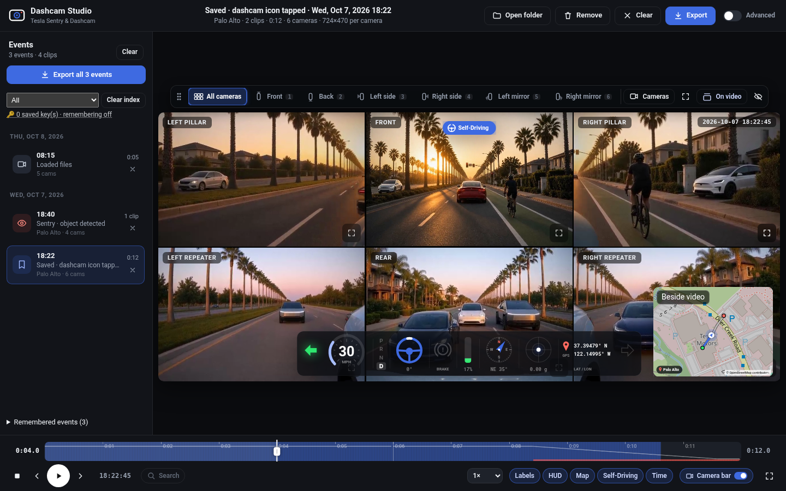
*Camera bar beside the video: it no longer covers the top row.*

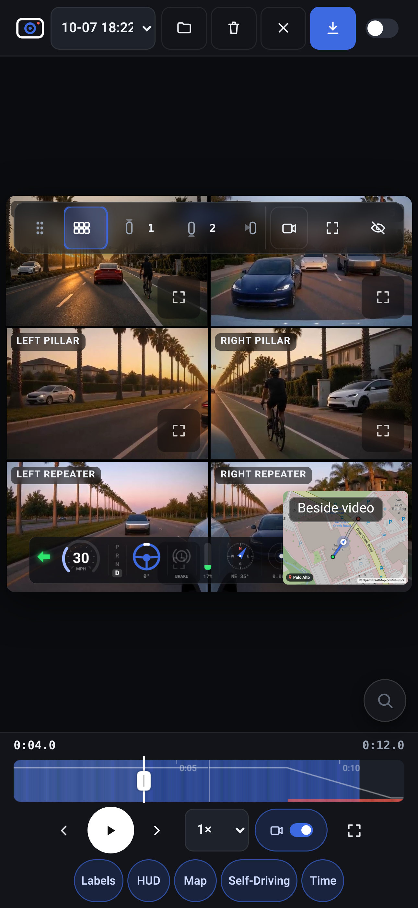
*iPhone, upright: 2 × 3 grid. Small phones scroll the grid instead of shrinking it.*

**On iPhone or iPad:** copy the clips into the Files app first, for example from the USB drive with a USB-C adapter. Then tap **Add files** and select the `.mp4` files (and `event.json` if there is one). The app groups them into events by the timestamps in their file names. Safari can't open a whole folder, so pick the files themselves. Use Files rather than the Photos picker, which may convert the videos.

## Search (Find + Redact in one box)
Tap **🔍 Search** next to the clock (on a phone, the round 🔍 button above the controls), or press **/** or **Ctrl+K / Cmd+K**. Type, then:
- **Find moment** (Enter) looks for a scene or object, such as "a cyclist in the bike lane".
- **Blur text** (Shift+Enter) hides those words wherever they appear. The chips (**Blur plates**, **Blur faces**, **Street signs**, **All text**) work as before.

Results drop down in two groups, **Find matches** and **Blurred text / regions**, each with its time. Click or tap one to jump there: a Find match switches to that camera and draws the gold box, and a text region focuses its camera and flashes a gold outline around it. **Esc** closes the box (a second Esc leaves the focused camera as before). The 🔍 button shows how many results there are.

The gold box on the video carries a small label with what was searched for. A picture-search result is labelled as a guess, e.g. "white car? (best match)" or "white car? (match)", never with a %. With object detection on, a detector result shows the real class and confidence, e.g. "car 91%". It's the same text the export burns in. It scales with the camera tile and never covers the buttons. See `screenshots/live-labels.png`.

**Burn detection boxes into the export:** in the Export dialog, tick **Burn detection boxes** (off by default; the choice is remembered). The gold box and its label (e.g. "white car? (best match)", or "car 91%" from the object detector) are then drawn into the exported video on the right camera, exactly as the viewer shows them at each moment: the viewer and the export use one function for "which boxes at this time". Boxes that follow an object (tracking after a search, or **Detect while playing**) move with it frame by frame; with **Detect while playing** on, the export first runs the same detection over the exported sections, on every camera with *All cameras* or the focused one otherwise, at the chosen speed ("Detecting objects for the burned-in boxes · N of M · Rear"), and it waits for gold-box tracking that is still running. A result that isn't followed shows for ±1 s around its moment. Unticking **Show the gold box** hides them in both. Text size follows the video size, with a dark background so it stays readable on a phone. Frames with no box are left untouched. See `screenshots/burn-boxes.png`.

On phones and narrow windows the box is a bottom sheet pinned above the on-screen keyboard. The video grid isn't resized while you type.

**Where the search box sits:** by default it's docked **below the video** in its own strip; the cameras shrink to fit above it and nothing is covered. In its header:
- **Float** (window icon) detaches it into a movable window. Drag the header (mouse, pen or finger) anywhere on screen, including outside the camera grid; it always stays fully on screen. Drag the corner to resize. With the ⋮⋮ grip focused, the arrow keys move it (Shift for bigger steps). Double-click the header to dock or float.
- **Pin** locks the floating window where you put it: no dragging or resizing until you unpin. If the window gets smaller it's kept on screen, and it goes back to your spot when there's room again.
- **Dock** (same button while floating) puts it back below the video.
The mode, position, size and pin are remembered on this device. Clicking the video no longer closes the box; use × or Esc. On a phone, while you type, the docked box lifts above the keyboard and the cameras stay put. See `screenshots/search-float-*.png`.

**Phone thumbnail strip:** on a phone in full screen (or with one camera enlarged), a strip sits just above the controls. **Results** shows a small picture of each match with its time, camera and label; tap one to jump there with the gold box. **Cameras** shows a snapshot of each camera; tap to switch (**All** goes back to the grid). The ⌄ button folds it away. Thumbnails are made only when they scroll into view, at 96 px, and freed when the results are cleared. Upright, the video is fitted above the strip; sideways the strip overlays the bottom like the controls and fades with them.

**Classic search bars:** Settings ▸ Search ▸ *Classic search bars* (or the checkbox at the bottom of the search box) brings back the original Find and Redact bars under the video. You can also open the app with `?search=classic`. If the new search ever fails to start, the classic bars appear on their own.

### Highlight or redact what you found
Under the search box, **Matches: Highlight · Redact** decide how the results look, in the viewer and in the export:
- **Highlight** (on by default): the outline and label around each match. It is the same switch as the **Boxes** button in the camera bar, the **X** key and the *Gold box* tick.
- **Redact** (off by default, **R** key): an opaque blur over each match (the same shrink-and-enlarge blur as Blur plates, so it looks the same in Safari, on an iPhone and in Chrome). The blur follows the match where it is followed (tracking, Detect while playing), and otherwise covers the result for ±1 s around its moment, like the outline. With object detection, only the searched class is blurred (searching `person` never blurs the cars).
- So you can have highlight only, redact only, both, or neither. Both switches are remembered on this device; the classic Find bar has the same two buttons.
- **Per term:** in a search for several things, every term chip has two small buttons, an outline (highlight) and a filled box (redact). Tap them to set that term on its own, e.g. `bus, person` with the people blurred and the bus outlined. A ringed button differs from the switch; tapping the switch again applies it to every term. Showing one term with its chip never un-blurs the others.
- **Export:** redacted matches are always burned into the file (even with **Burn detection boxes** unticked or Highlight off); outlines are burned in when Highlight is on and **Burn detection boxes** is ticked. The Export dialog says which. The viewer and the export read the same list of boxes, so the file matches the screen.
- See `screenshots/redact-toggle-panel.png` (the switches and the per-term buttons for `bus, person`) and `screenshots/redact-toggle-viewer.png` (bus redacted, person highlighted; synthetic footage).
- **Blur text / plates / faces** results have their own **Show blur** button in the search panel (and the classic Redact bar): off shows the original picture in the viewer and the export, on blurs it again. Running Blur text, Blur plates or All text again keeps it on.

### Several things in one search
Type them together, separated by commas, `and`, `or`, `+`, `/` or `;`, for example **`bus, person, police car`**, **`red car and cyclist`**, **`traffic light / stop sign`**, **`white police car + person`** or **`bus, plate 7AB*`**. One scan goes over every camera, and each frame is detected once for all the terms, so it is much faster than searching for each one in turn. Each term gets a coloured chip with its number of results (in the search panel, the floating search and the phone strip). Tap a chip to show only that term and tap **All** to show everything again. In the viewer and in the burned-in export each term's boxes have its colour; the result you opened stays gold.
- Names with several words stay together (`traffic light`, `stop sign`, `fire hydrant`, `tour bus`, `white police car`), and a colour on its own joins what follows (`black and white police car`).
- `and` / `or` only split when every part is something the searches know (an object, a vehicle, a plate); a sentence like `a person in a hoodie and a mask` goes to the picture search whole. Commas always split, so `bus, a man walking a dog` searches the bus with the detector and the rest with the picture search.
- Objects need Settings ▸ Object detection on; vehicle words (colour, type, make) need Vehicle details; plates need Plates & text. Without them a term falls back to the picture search, like a single search.
- **Best match only** applies to plate terms; the other terms always show all their results. Up to 6 terms.

### Jump to a time
Type a time in the search box and press Enter. Every camera jumps there together.
- **`20:53:46`**, **`8:53 pm`**, **`8:53:46 PM`**, **`at 20:53:46`** are clock times (the time in the clip names / the Tesla timestamp). The result reads e.g. **"Jump to 20:53:46 (2:15 into the event)"**.
- **`2:30`**, **`90s`**, **`1m30s`**, **`t=90`** are positions in the event (the clock time is shown next to it).
- **`+1:05`**, **`-10s`** move from where you are.
- A time outside the event says so and offers the nearest end, e.g. "23:10:00 is not in this event (20:51:31–20:54:31). Jump to the end instead". Nothing is downloaded for time search and it works with text search turned off.

### Search for text (beta)
Type **`text Oak Ave`** (or `sign: …`, or the words in quotes, or a bare ALL-CAPS phrase such as `ZENDER BAKERY` that isn't a plate or an object) and press Enter. The first text search of an event reads every camera once (about one frame a second; around a minute for a 10 s, 6-camera event on a laptop), then every further text search, **Blur text** and **All text** use what was read and answer at once. Results list the time, the camera, a thumbnail and what was read, e.g. "0:06.2 · Rear · “PELLOCAFE” · read 99% · 10 frames"; tap one to jump there and the gold box follows the text. Matching allows small OCR slips (0/O, 1/l, 8/B, one or two letters) and a cut-off sign, but a short number like `4821` must be read exactly, and a common word on its own (`St`, `Ave`) never matches.

**Settings ▸ Search ▸ Show text search & redaction (beta)** (on by default, remembered on this device). Off hides the text-to-hide box, **Blur text**, **Street signs** and **All text**, and `text …` searches say the feature is off. **Blur plates**, **Blur faces** and time search stay.

## Recognition settings
Settings ▸ **Recognition (beta)** has five switches: *Find objects in search*, *Show boxes while playing*, *Vehicle colour & type*, *Read licence plates* and *Blur licence plates*, plus *Speed while playing*. A switch that needs another one turns it on. Everything else (models, thresholds, cameras, street signs, make & model, cloud boost, index buttons) is under **Advanced recognition settings**. It is collapsed by default and remembers whether it was open. The sections below describe those controls.

## Object detection (beta)
Settings ▸ **Object detection** (off until you turn it on). When it's on, a search for an object name (**car**, **person**, **truck**, **bicycle**, **dog**, **traffic light**… any of the 80 COCO classes, plurals and a few synonyms such as "people" or "bike") uses a YOLO11 object detector instead of the picture search. Results show the real class and confidence ("car 91%") on the gold box, and the box **follows the object**: frames ±2.5 s around the match are detected and linked with a simple IoU tracker. Export burns the same boxes in when **Burn detection boxes** is ticked. Any other phrase still uses the existing picture search. With **Grounding DINO** picked, any phrase goes to the detector.

- **Model:** YOLO11 nano (10.7 MB, the default on phones), YOLO11 small (38 MB, the default on computers), or Grounding DINO tiny (experimental: 150–200 MB download, only sensible on a computer with WebGPU).
- **Small objects:** umbrellas, bags, signs and other usually-small classes get a lower threshold (60% of the setting) and, when the whole frame finds none, a second look at four zoomed, overlapping tiles. This costs up to 5× the time for those frames. **Always zoom** applies it to every search; **Off** disables it.
- **Confidence:** the threshold (default 35%). **Detect while playing:** optional. Boxes follow objects on every frame: each new detection starts as soon as the previous one finishes, and in between a tracker predicts and smooths each box (a box disappears ~0.5 s after its object is no longer seen).
- **Cameras for Detect while playing:** *All cameras* (default on computers) checks every camera you can see. A camera with a moving box is checked about four times as often as one showing still or no objects, and big tiles more often than small ones (tag live-lag). Between checks each box keeps moving at its measured speed to the frame on screen, then slows down. *Focused camera* (default on phones) checks only the big one. A camera hidden behind a focused camera isn't checked.
- **Detection speed:** *Fast* (as fast as the device can, with a smaller 320-pixel model, `models/yolo11n-320.onnx`), *Balanced* (default, up to ~5 detections a second), *Battery saver* (about 1 a second; the default on phones when the battery is low or, on iPhone, when Low Power Mode seems to be on). Measured on the test box (WASM, one CPU thread, 2 cameras): Fast ≈ 9/s, Balanced ≈ 3/s, Battery saver ≈ 1/s, in Chromium and WebKit. Playback stayed at full frame rate in Chromium; in headless WebKit it dropped about 10–15%, the same as with the old once-a-second detection.
- **Search for an object (e.g. "bus")** always checks every camera, a frame every 1–2 s, and its results also include everything Detect while playing has already seen. Vehicle details ("city bus", "red tour bus") refine the detector's bus results; if none is confirmed, the detector's bus moments are still shown, marked "not confirmed".
- It runs in a background worker with onnxruntime-web: WebGPU when the device has a real GPU adapter, otherwise WASM. The status line shows which one. **Safari (Mac and iPhone) and every iOS browser always use WASM:** onnxruntime-web's WebGPU build runs away with memory in Safari/WebKit 26+ and the browser silently kills the worker. To try WebGPU there anyway, run `localStorage.setItem('tdc.webgpu','on')` in the console (`'off'` forces WASM everywhere). The model is downloaded once, then kept in IndexedDB. That works on plain-http home-network addresses too, where the browser cache isn't available.
- **Person right behind the car (legs-fix):** on a wide REAR camera a person who walks very close, with only the legs or dark lower body in view, is often called a *cat* by the model (it is that sure of it: cat 82%, person under 1% in the case that was measured). So a score cut-off cannot fix it. Instead a *big* animal box is treated as a person candidate: on the rear camera any animal class that fills 20% of the frame (or 10%, or 5% if it is tall and touches a frame edge) and on the other cameras a *cat, dog or teddy bear* that fills 30% (18%, or 10% touching an edge). The biggest ones become a person right away; the others are a weak person that needs 3 looks (about the same rule as the zoomed hand-off looks) and, live, get a zoomed second look at the legs. On the rear camera a low-scoring person box that touches the frame edge (legs only) is also kept as a weak look from 20%. Small or far-away animals keep their animal label. The corrected label is used everywhere (live boxes, search, export, hand-off cue, car view and people list). Turn it off with `localStorage.setItem("tdc.legsfix","0")` in the browser console.
- If the model or runtime can't load (offline, blocked CDN, old browser), the app says so and falls back to the picture search. Playback, keys and export are not affected.
- The detection runtime (onnxruntime-web 1.22) is included in `vendor/ort/`, with jsDelivr only as a backup. YOLO needs no internet once the page is served. Grounding DINO still downloads transformers.js and its model from the internet.
- It works with any static web server, including ones that send the wrong file types for `.js`/`.mjs`/`.wasm` (e.g. Windows `python -m http.server`). The worker and runtime are loaded from in-memory copies with the right type.
- **License:** the YOLO11 weights are **AGPL-3.0** (Ultralytics). See [`models/README.md`](models/README.md).

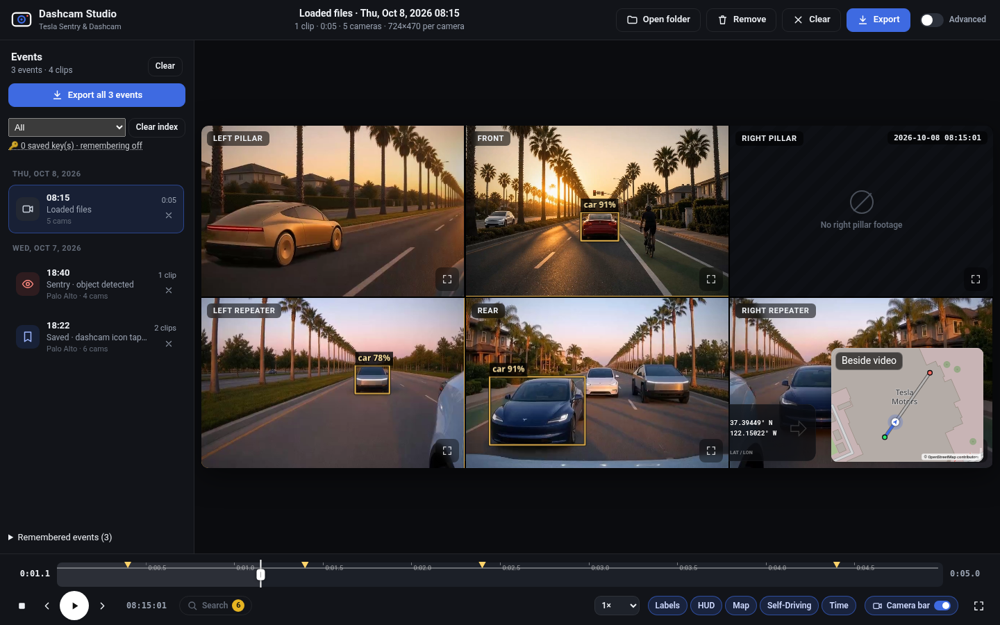

## Layouts, hand-off cue, car view, cross-camera matching (beta)
The layout and hand-off cue are display-only: redaction, white balance and the 360 view keep their own fixed camera order and raw pictures. Export follows the layout only if you leave **Camera order** on *Match viewer* (see *Export: where the map, HUD and car view go*).

- **Layout** (the *Camera layout* menu above the grid). **Current**: top *Left pillar | Front | Right pillar*, bottom *Left repeater | Rear | Right repeater*. **Rear view**: the bottom row is *Right repeater | Rear | Left repeater*, the order you see when you look back at the car. **Mirrored bottom row**: *Left repeater | Rear | Right repeater* (the same order as Current) with the three bottom videos flipped like a mirror (labels and boxes stay readable). **Auto** (default): Sentry events use Rear view, Dashcam / saved / recent clips use Current. The choice is remembered.
- **Hand-off cue** (chip **Hand-off**, on by default, needs object detection and *Detect while playing*; Sentry events track people on every camera). When a person walks out of one camera, the neighbouring camera's entry edge glows in that person's colour with an arrow. The neighbour comes from the fixed order around the car (front → right pillar → right repeater → rear → left repeater → left pillar → front), not from the layout. While someone is near an edge their neighbour gets extra detection looks.
- **Car view** (chip **Car view**, off by default, remembered). A floating card: a small top-down car with the six cameras as wedges and a tiny person icon for everyone tracked, in their own colour (the same colour is on their boxes in the picture). Tap a person or the legend chip (P1, P2…) to highlight them. **Drag** it by its header (mouse or touch) anywhere in the window, including outside the video grid; **resize** it with the corner handle; **pin** it (📌) to lock position and size (saved per device, close/collapse hide while pinned); collapse or close it when not pinned. Showing or moving it never shifts the grid. **Export**: the export dialog has a tick **Include car view** (on by default while the car view is visible, hidden when it is off); the card is drawn into the video at the same relative place and size, and if it sits outside the grid it is moved to the nearest edge or corner of the picture so it is fully visible. Compact on phones (about 100 px wide).
- **Cross-camera matching (beta)** (Settings ▸ Object detection). One person keeps one number and one colour when they pass from camera to camera. Each link is a **best guess** (labelled `P1?`) from: where and when the person left one picture and appeared in the next, which way they were walking, and what they look like. What they look like is, in order of preference, an **appearance vector** from a small bundled re-identification model (`models/reid/`, Apache-2.0, 0.8 MB, runs in the detection worker), or a **clothing-colour histogram** (always available, cheap). The model uses **WebGPU only where the app really runs WebGPU** (a real GPU adapter; never on Safari or iOS Safari unless you add `?webgpu=on`), otherwise **WASM**, and only for people near a picture edge or just appeared, a few crops a second. **Default Auto:** on when this device keeps up, off when it would slow playback (descriptors slower than 8 ms on a computer / 14 ms on a phone, or an appearance model slower than 220 / 320 ms per crop switches itself down: appearance model → colour only → matching off). Tick or untick it in Settings to force it. The status line under the checkbox says what is running. Nothing is uploaded.
- **Limits, honestly:** dark pictures and the fisheye rear camera give poor appearance; crowds and people in similar clothes get mixed up (the app prefers "new person" over a doubtful link); a person who is hidden for longer than ~10 s is a new person; it is not face recognition and does not follow someone through a gap in the cameras (nothing sees the sides between the pillars and the repeaters). On phones live detection is on the *Focused* camera by default, so hand-offs between cameras you are not looking at are only seen on Sentry events or when you choose *All cameras*. Real-GPU speed of the appearance model has not been measured by the author (the test machine has no GPU); on CPU/WASM it takes about 12 ms per crop on a computer.
- **Try it** (Mac Safari / iPhone): open Settings ▸ Object detection, tick *Use object detection…* and *Detect while playing*, leave *Cross-camera matching (beta)* ticked, open a Sentry event and press play. Add `?debug=det` to the address for live numbers, `?webgpu=on|off|auto` to override the WebGPU choice. Tests: `node test/handoff.test.js`, `test/layout-presets.js`, `test/handoff-cue.js`, `test/car-view.js`, `test/reid-ui.js`, `test/reid-eval.js`, `test/reid-webgpu.js`, `test/reid-perf.js` (run Chromium and WebKit separately: `BR=chromium|webkit node test/…`).

## Export: where the map, HUD and car view go (export-panel)
In the Export dialog (Most Compatible and Original resolution; the 360 export is unchanged):

- **Map, HUD & car view** has three choices.
  - **On the picture** is the old behaviour: they float over the cameras where they sit in the viewer.
  - **Fill black area** puts them into the black strip that Most Compatible (1920×1080) has under the cameras, so the picture stays exactly 1920×1080. The date and time sit in a thin row at the top of that strip. It is only offered when the strip is at least 96 px tall (a normal Tesla picture leaves about 250 px).
  - **Add panel** makes the picture bigger instead: an extra strip is added below the camera grid (at the side if the grid were ever taller than wide). With **Original resolution** the grid stays at full native size, pixel for pixel, with nothing scaled; with Most Compatible the grid keeps its 1920-wide size and the output becomes taller than 1080 (for example 1920×1210), so it is no longer a 16:9 file.
  - **Default** (until you pick one, then your choice is remembered): *Fill black area* when the output has a black strip, otherwise *Add panel*. If you pick Fill on an output with no black area, the export uses Add panel and says so.
- **Include HUD / Include map / Include car view** ticks. HUD and map ticks appear only when there is telemetry or a route (a map also with just an event location); they start ticked when they are on in the viewer. The car-view tick is as before (only when the car view is on screen). With Fill or Add panel an unticked item is not drawn anywhere; if nothing is ticked there is no strip and the size is the plain grid.
- **Output size.** The dialog shows the final picture size, what is in it, and the codec, and warns when it had to change something.
- **Encoder limits.** The size is checked with `VideoEncoder.isConfigSupported`, the same way as before. If the device's *hardware* encoder takes the plain grid but not the grid plus the strip, the strip is made thinner (about half) so the export stays on hardware; if that still doesn't fit, the order is: 75%, 50%, then plain 1920×1080, each with a warning. For Most Compatible + Add panel the fallback is Fill black area at 1920×1080. Sizes are always even, H.264 level is chosen from the final size, and the strip is never more than about 35% of the grid height.
- **Map in the export** is drawn from the route with a position dot, on OpenStreetMap tiles when they could be loaded with CORS (so the picture is not tainted), otherwise as a plain track. **HUD** is the same HUD as the viewer (speed, gear, steering, pedals, signals, compass, g-force, GPS), scaled to fit; **car view** is the same card as in the viewer.
- **Camera order.** *Match viewer* (default) uses the viewer's layout: *Rear view* swaps the bottom repeaters, *Mirrored bottom row* also flips the three bottom pictures left-right (the detection boxes follow the flipped picture, their text stays readable). *Standard fixed order* is always left pillar · front · right pillar / left repeater · rear · right repeater, never flipped. Remembered. The 360 view is separate.
- **Export all** (the button for the whole library) keeps the old look: panels on the picture, standard order.
- Limits: a very long strip of panels on a phone-size picture gets small; the map panel has no tiles when the device is offline; Safari/iPhone may refuse the taller picture and then fall back as above (the dialog shows what it will use).
- Test: `node test/export-panel.js` (`BR=chromium|webkit DEV=desktop|phone`, `NOEXPORT=1` skips the encode checks).

## Export: choose cameras (export-cams)
The Export dialog has a **Cameras** row (Most Compatible and Original resolution; hidden for the 360 equirect preset, which needs all six). All six are ticked by default, so nothing changes unless you untick.
- **Chips** for the six cameras in the export order (so they follow *Match viewer* / *Standard fixed order*), tick box + name; a camera with no footage in the event says *No footage* (ticked it keeps today's "No … footage" placeholder; unticked it is simply left out). At least one stays ticked (the last one is locked with a hint).
- **Quick choices:** All, Front only, Front + Rear, Sides (both pillars and both repeaters), and *Focused camera* (only while a camera is focused in the viewer).
- **Summary + picture:** "Exporting 3 of 6 cameras (Left Repeater, Rear, Right Repeater) · 1920×1080" and a small drawing of the real output layout (cameras, free spot, map / HUD / car view).
- **Layout re-flows by count, at native tile size** (no stretching): 1 camera 1×1, 2 side by side, 3 → 2×2 with a free cell, 4 → 2×2, 5 → 3×2 with a free cell, 6 → 3×2 as before. Original resolution lists native sizes for that shape. In the free cell (3 or 5 cameras) the map, HUD and car view are drawn, with nothing added and no black strip. For 1 and 4 cameras (a 4:3 picture in a 16:9 frame) *Fill black area* uses the black area beside the cameras (grid flush left); *Add panel* adds a strip as before; 2 cameras fill the strip below.
- **File name** gets the cameras after the trigger when not all six: `…_sentry_front_compatible_1920x1080_h264.mp4`, `…_sentry_3cams_…`. All six: the old name.
- **Faster:** only the ticked cameras are decoded. Burned detection boxes, redaction and the car view follow the moved pictures. Match viewer keeps the viewer's relative order (and flips) for the ticked cameras.
- **Not remembered between sessions** on purpose (a forgotten "front only" would silently cut the next export); it stays while the page is open. Not in preferences or localStorage.
- Limits: box burning / plate / detection prep still look at all six cameras (decode saving is for the pictures only); the real-time recorder (browsers without WebCodecs encoders) draws the ticked cameras the same way.
- Test: `BR=chromium|webkit node test/export-cams.js` (`DEV=desktop|phone`, `NOEXPORT=1`, `SHOTS=dir` writes mock-data screenshots).

## Plates & street names (beta)
Settings ▸ **Plates & text** (off until you turn it on). Then type a plate in the search box:

- `plate 7ABC234` (exact), `7ABC 23` (part of a plate, spaces and dashes ignored), `7AB*` or `7A?C234` (wildcards), `plates` (every plate in the event).
- Look-alike characters still match: searching `5SMP26O` finds 5SMP260 (O/0, I/1, B/8, S/5, Z/2, G/6), and one wrong character is allowed for 5+ characters.
- `street Palm Ave` finds street-name signs and other sign text (tick **Also read street names and signs**; slower). "Ave"/"Avenue", "St"/"Street" etc. are treated as the same.

The first plate search on an event reads it once (about one frame per second per camera; the status line counts the frames). The plates and street text are kept in this browser's library index, so later searches on that event, even after a reload, are instant. The index stores only the text, time, camera, box and confidence (never pictures or video). **Forget plate & text index** clears it. Results show as `0:04.2 · Front · 7TST123 98%`; the gold box reads `plate 7TST123 98%` and follows the plate across nearby frames, and **Burn detection boxes** puts the same label in the export.

**Results and Best match:** every reading of the same plate (any camera, any time in the event) is merged into one result; its gold box and thumbnail use the clearest sighting. Each result is labelled the same way in the results list, on the gold box, in the exported video and in the phone strip:

`7ABC234 · match 100% · read 91% · seen 2× · Best match`

- **match** = how closely the reading fits what you typed (100% exact, 95% wildcard, 90% part of a plate, lower for look-alikes or one wrong character). Left out for `plates` / `street` with no words, where everything matches.
- **read** = how sure the on-device reader is about the characters. **checked by Grok / Claude / Gemini** is added after a cloud re-check.
- **seen N×** = the plate showed up N separate times (different cameras, or more than 2 s apart).
- **Best match** = the highest *match × read*. Plates within 2 points of the top all get it (a tie).

Tick **Best match only** in the search box (or **★ Best only** in the phone strip) to show just the best match. The list, gold box, timeline marks, phone thumbnails and *Burn detection boxes* in the export then follow it; plate blurring does not (every plate found is still blurred). The choice is remembered on this device. See `screenshots/plate-bestmatch-*.png`.

**Blur licence plates:** tick it in Settings ▸ Plates & text or in the Export dialog. Plates found by the reader are blurred on the live player and in the exported video, in every browser (Safari has no canvas blur filter, so the app uses its own). Ticking it reads the open event in the background if it hasn't been read yet (status line under the setting); search and export wait for that one scan. Plates are always read from the raw video, so search still finds blurred plates. The existing **Blur plates** chip in Redact now uses the real plate finder too when Plates & text is on (otherwise it keeps the old text-shape guess).

- **Models** (all MIT, included in `models/plates/` and loaded only from there, so it works on plain-http home-network addresses; they are not in the offline pack (13 MB), the service worker keeps them after plates are first used; IndexedDB is only a cache): [open-image-models](https://github.com/ankandrew/open-image-models) YOLOv9-tiny plate finder, **Fast** 384 px (default on phones) or **Accurate** 640 px (default on computers), 7.8 MB each; [fast-plate-ocr](https://github.com/ankandrew/fast-plate-ocr) CCT-S reader, 5.3 MB. Street text uses the PP-OCR text finder already bundled for Redact. Details and checksums: [`models/README.md`](models/README.md).
- **California format:** readings of 7 characters are fitted to the standard 1ABC234 pattern (digit, 3 letters, 3 digits): a character of the wrong kind is replaced by the reader's second choice, or by its look-alike, and its confidence is lowered. Vanity, commercial and other states' plates are kept as read.
- **Settings:** plate finder size, "find plates above" (default 30%), "trust readings above" (default 40%; weaker readings show as *weak*), far plates (zoomed tiles for big HW4 frames on computers; Always / Off), street names, blur.
- **Speed** (headless Chrome, box CPU, WASM, one thread): Fast 0.12 s + reading 0.08 s per frame, Accurate 0.3 s + 0.08 s. An 8 s, 2-camera event was read in 7.9 s. Phones are slower; Fast is the default there.
- **"Plate reading unavailable"** names what went wrong: a file that couldn't be fetched, a script error, or the step the worker was on when the browser stopped it ("the browser stopped the worker while starting the model on WebGPU" usually means out of memory or a WebGPU problem). A worker killed while starting WebGPU is retried once on WASM automatically. Plates start their worker the same way as object detection, whether or not detection is turned on.
- Readings can be wrong. Treat a plate as a lead and check the video. If a model can't load, plate search says why; playback, keys, decryption and export work as before.

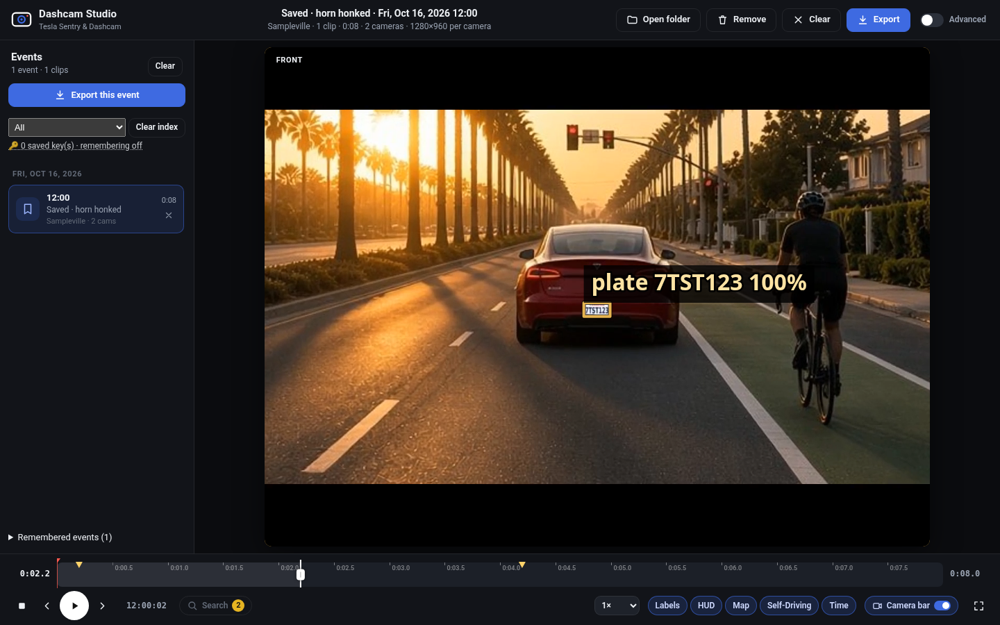

## Vehicle details (beta): colour, bus type, police / ambulance / fire, make & model
Settings ▸ **Vehicle details (beta)** (off until you turn it on; **Also guess make & model** is a separate switch, also off). Then type what you are looking for in the search box:

- `red tour bus`, `city bus`, `school bus`, `white police car`, `ambulance`, `red fire truck`, `yellow taxi`, `blue pickup truck`, `silver SUV`, `black Tesla Model Y`, `blue Toyota`. Longer phrases work too ("tour bus and regular local street buses"). Chips under the box show how it was read: `color: red` `type: tour bus` `detector: bus`.
- Plate phrases go to the plate search: `blur the license plate`, `find plate 7ABC`, `licence plates`, `tag starting with 7AB`. "blur …" also turns on **Blur licence plates**. If Plates & text is off it says so instead of running the picture search.

How it works (two stages, all on this device): the object detector (YOLO11) finds cars, buses and trucks; each box is then described. **Colour** comes from the box's pixels (centre-weighted, 12 named colours, a second colour is kept for two-tone vehicles). **Type / role** (tour bus vs city bus, school bus, minibus, police car, ambulance, fire truck, taxi, delivery van, pickup, semi, box truck, SUV, sedan, hatchback, sports car) and **make & model** (26 common US brands, about 90 models) come from the CLIP picture model the picture search already uses, asked "a photo of a … " about each crop. CLIP is only loaded when the query names a type or make; `red bus` uses colour alone.

Results use the same label everywhere (list, gold box that follows the vehicle, live labels, *Burn detection boxes* in the export, phone strip): `red tour bus · bus 95% · type 61% · color red · Best match` (detector confidence, type/make confidence, colour). **Best match only** works as for plates. The detected boxes and their colour/type/make guesses (numbers only, no pictures) are kept in the library index, so a repeat search on the same event is instant (0.3 s instead of 10 s); **Forget vehicle index** clears it.

- **Accuracy** on 37 public-domain / CC0 Wikimedia Commons photos (see `models/README.md`): detector class 37/37; colour exact ~61–70%, accepted by the colour query ~91%; type ~86% top-1 (tour vs city bus 13/15); make ~70% top-1, make + model only ~20–40%. Treat make/model as a hint.
- **Speed** (headless, box CPU, WASM): detector ~0.8 s per frame, CLIP ~0.2 s per vehicle crop, colour ~1 ms. Search samples up to 60 frames (30 on phones) and checks up to 4 vehicles per frame (2 on phones).
- **Colour lock:** each vehicle keeps one colour while it is followed. Its colour readings are weighed over the whole time it is seen; lit lamps, low light, small or cut-off crops and overlaps count less. The label shows `~white` while still deciding, then `white` once locked. A locked colour changes only after ≥ 1.5 s of clearly different good readings. Live labels, the export and search results use the same locked colour.
- **Limits:** colour is unreliable at night and under orange sodium street lights (the label then reads `color red? (low light)` and the colour counts for less); sky reflections push white/silver towards blue. Double-decker sightseeing buses can be read as city buses. Make & model is zero-shot and weak on look-alikes and recent facelifts. If the CLIP model can't load, it says "Vehicle details unavailable (…)" and plain words keep using the picture search; playback, keys, decryption and export are not affected.

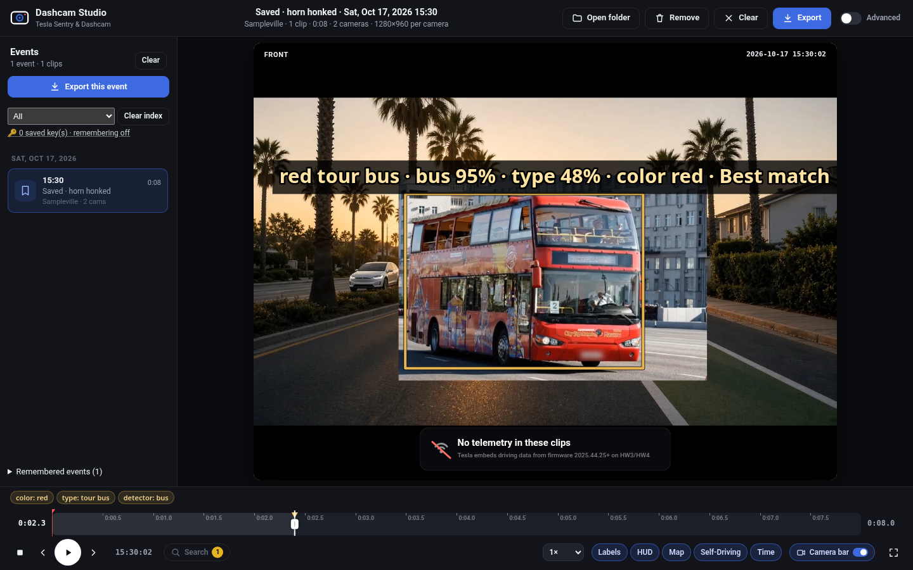

## Cloud boost (optional: Grok, Claude or Gemini)
Off by default; the on-device plate reader and detector above always come first. In Settings ▸ **Cloud boost** you can pick **Grok (xAI)**, **Claude (Anthropic)** or **Gemini (Google)** and paste **your own API key**. Then:

- **Re-check weak plates:** after a plate search, a **Re-check N weak plates with Grok/Claude/Gemini** button appears under the search status when some readings are below "trust readings above". It sends a small crop around each unsure plate (one per plate per ~4 s, up to "calls per run"). The answer is stored next to the local reading (the local one is kept), and results say `· checked by Claude`. Search again to use the corrected text.
- **Ask anything:** start a search with `ask `, for example `ask a red umbrella` or `ask a white van with a ladder`. A few frames, spread over the event, are sent downscaled (longest side ≤ 1024 px). The model returns boxes as JSON; they show as gold boxes with its label, text and confidence. These boxes are per frame and aren't tracked.

**Before anything is sent** a dialog shows which host gets the pictures (`api.x.ai`, `api.anthropic.com` or `generativelanguage.googleapis.com`), that frames leave your device, that each call is billed to your account, and roughly how many calls. Cancel sends nothing. "Don't ask again" is remembered per provider until **Forget API keys**.

- **Key storage:** in this tab only (sessionStorage) unless you tick **Remember key on this device** (localStorage, not encrypted). The key goes only to the provider you chose (or to the local companion if you turn on its relay). It is never put in the repo, URLs, logs or the library index. **Forget API keys** clears all keys and consents.
- **Cost control:** one call at a time, at least 1.5 s apart, at most "calls per run" per action (default 12). Default models are small and cheap; you can type another model name: `grok-4.3`, `claude-haiku-5-5`, `gemini-3.5-flash-lite` (as of Oct 2026; see each provider's model list).
- **Browser access (CORS), checked Oct 16, 2026:** all three APIs accept direct calls from a web page (x.ai and Anthropic answer `Access-Control-Allow-Origin: *`; Anthropic needs the `anthropic-dangerous-direct-browser-access` header, which the app sends; Google echoes the page's origin for `x-goog-api-key`). If a provider changes that, the error says so. When the app runs inside the **companion** (`/app/…?companion=1`), tick **Use companion** to relay calls through `127.0.0.1`. The relay only forwards POSTs to those three API paths with their auth headers, needs the companion token, and stores nothing.
- **Honest status:** request formats follow each provider's current docs and are tested against **mocked** providers (Chromium and WebKit). They have **not** been tried with real API keys here. Cloud answers can be wrong too; treat them as leads.

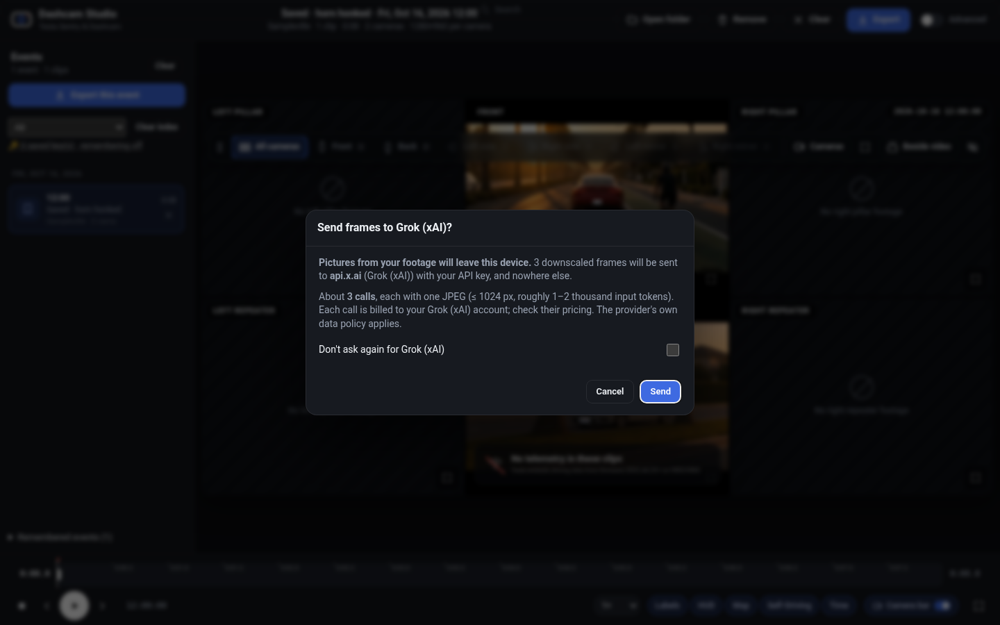

## Live white balance (viewer only)
Night clips under streetlights often look orange. Tap **White balance** in the bar under the video (next to **HUD** and **Map**) to correct the colours live, in the viewer only.

- **How it finds the light:** your car is white, and each mirror camera (left and right repeater) sees a thin sliver of the car body along its **outer** edge: the far left of the left repeater's image and the far right of the right repeater's, wider toward the bottom. At night that paint is a dim grey/beige sliver lit by the streetlight; its colour is the colour of the light. The app finds the body by itself: while you drive the world moves past but the body and its edge stay still, so after a few seconds it learns the body's shape (and remembers it per camera). Until then it uses a default wedge-shaped sliver. Inside the body it takes the 60–95th percentile of brightness (no bright highlight needed; clipped and very dark pixels are skipped, and "paint seen" adapts to how bright the scene is) a few times a second and smooths it over several samples.
- **Settings > White balance:** *Strength* (default 70 %), *Strip width* (how far in from the edge to look for the body), *Car body edge* per mirror camera (auto / left edge / right edge, for unusual mounts or mirrored footage) and *Show sample area*, which outlines the strip and paints the body pixels being sampled in magenta on the video, with "Body found · left edge" or "Default sliver" on the tile.
- **What it does:** it moves all the camera videos about **70 %** of the way toward neutral (gains are limited, since the paint isn't perfectly neutral, so it never over-corrects), keeping their brightness. HUD, map, labels, detection boxes, the gold box, search chips, the Self-Driving badge and the time keep their own colours.
- **Readout** (bottom right of the video), e.g. `3200 K · Warm streetlight · both mirrors` (or *left mirror* / *right mirror*). The light is described as *Sodium streetlight* (below about 2300 K or strongly orange), *Warm streetlight*, *Neutral light*, *Cool light* or *Daylight*. When it can't see the paint: *Looking for your white paint in the mirror cameras* (no correction is applied then).
- **Lamps:** a sudden red or green reflection (brake light, traffic light) is ignored: strongly red or green pixels are skipped, and a sudden colour jump on one mirror is rejected unless it lasts about 3 seconds (a real change of light).
- **Export is not changed.** Exports, detection, search and the 360 export always use the original frames. The setting is remembered. It works in the grid, the full-screen single camera (with zoom) and the 360 view.
- **Vehicle colour uses it too.** Searches like `white bus` and the live colour labels judge a vehicle's colour on pixels corrected with the white point from the mirror cameras at that moment (full correction, not 70 %), so a white bus under an orange streetlight reads *white*, not brown. The label says so: `color white (corrected for 2900 K light)`. Settings ▸ White balance ▸ **Colour search uses white balance**: *Auto* (default: whenever the car body is found in the mirrors, even with the White balance toggle off), *On*, *Off* (raw colours). Detection boxes and exports still use the original frames.
- **Limits (look):** temperature and tint are limited separately. At night the blue is held back (blue gain ≤ 1.45, magenta tint halved). In daylight (bright mirror strips) only a small correction (≤ 4 %) is applied, so 6300–7700 K daylight isn't pushed red.
- **Match cameras** (on by default): every camera uses the same mirror white point. Each camera is also nudged toward the mirror cameras using its own near-neutral pixels (at most ±7 %, smoothed), so the six views look alike.
- **Debug (live detection):** add `?debug=det` to the address to see the detector backend (WASM / WebGPU), its threads, looks per second for each camera, the time of one look and of the model, and a Prediction on/off button. `?webgpu=on` tries WebGPU (it is off by default in Safari and on iPhone, because onnxruntime-web's WebGPU build crashes there; WebGPU also needs https or localhost). `?webgpu=auto` goes back to the default.
- **Debug:** add `?debug=wb` to the address to see each camera's picture size and position, the screen's pixel ratio and the colour layers in use (with a Copy button). It's handy for reporting display problems.
- Off by default; turning it off removes the correction at once and stops the sampling. Sampling also pauses while the tab is hidden.

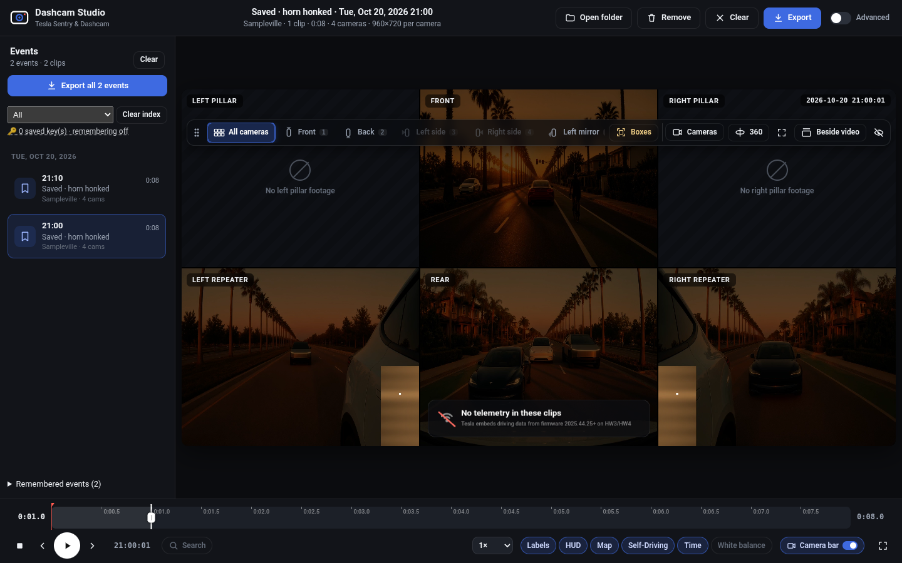
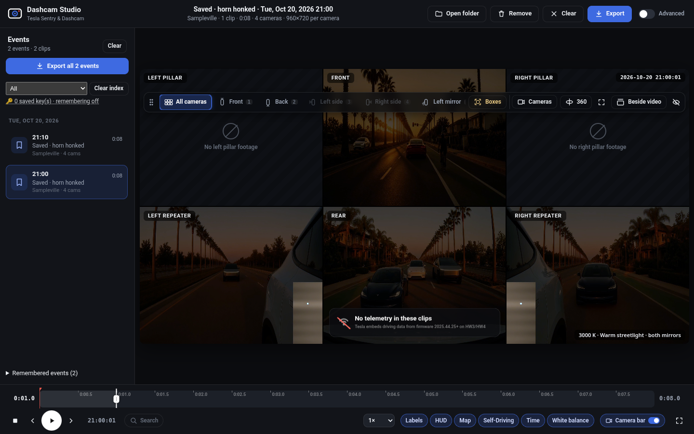
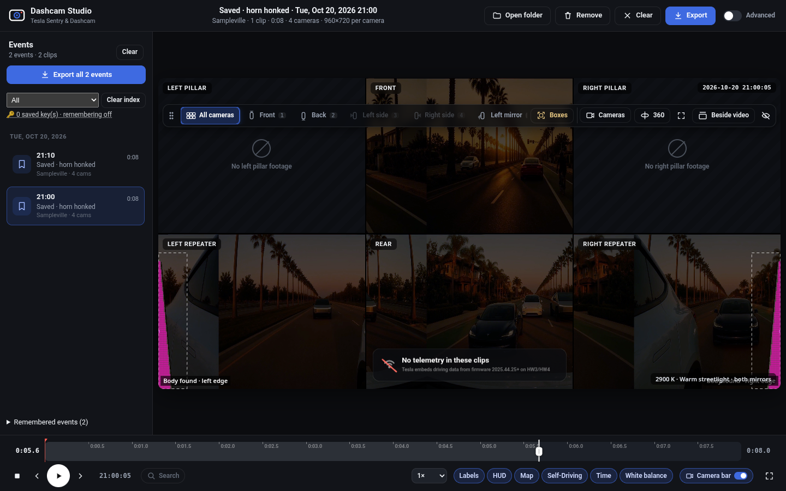

- **Colour constancy (prototype, off by default):** Settings ▸ White balance ▸ *Colour constancy*. Uses more references (lane markings, plates, a small 1.8 MB on-device model) and CAT16 / Bradford adaptation for colour search and export labels; optional CLIP colour check. On the synthetic test it raises strict colour accuracy from 56 % to 64–65 %, but it can be worse on some real clips. Details in CHANGES-v2.md.

## 360 view (beta prototype)
**Off by default (tag `ui-quick`).** The 360 button and the 360 export are hidden until you tick **Settings ▸ Labs (beta) ▸ Show 360 view (beta)** (Settings is under Advanced). The setting is remembered; **Reset all settings** hides it again. `?show360=1` shows it for one visit without saving, `?show360=0` hides it for one visit. If it is switched off while the 360 view is open, the view closes first; a saved 360 export choice opens as Most Compatible. The *Calibration* section in Settings (steering / acceleration signs) is not part of 360 and stays.

Tap **360** in the camera bar. The six cameras are stitched on your device's GPU (WebGL2, or WebGL1 on older browsers) into one view around the car:
- **Look around:** drag to turn, pinch or scroll to zoom, double-click to reset. **Gyro** uses the phone's motion sensor (iPhone asks for permission).
- **Flat 360:** the whole equirectangular 2:1 picture.
- Each camera is undistorted with a lens model (fisheye Kannala–Brandt or rectilinear) and placed by its estimated angle. Overlaps are feather-blended, and areas no camera sees (above the car, and the gaps around it) are dark.
- **The camera angles and fields of view are estimates** from public information: Tesla lists the main forward camera at about 50°, wide 120°, B-pillar "forward-looking side" cameras at 90°, and fender repeaters aimed about 45° toward the rear. They will not line up perfectly on every car. **Advanced ▸ 360 ▸ Calibrate** adjusts yaw, pitch, roll, field of view and k1 per camera with a live preview, saves on this device, and exports/imports JSON. Automatic refinement (feature matching in the overlaps) is not built yet.
- All cameras are projected as if things were far away, so close objects in the overlaps can show double or ghosted.
- With 360 off nothing extra loads (`js/pano.js` is fetched on first use). Phones render at half resolution and at most 30 fps; nothing is drawn while the video is paused and unchanged, or while the tab is hidden.
- **Export:** Advanced ▸ Export ▸ **360 equirectangular (beta)** writes a 2048×1024 MP4 (WebCodecs browsers). The file has **no spherical metadata**. Before uploading to YouTube or a 360 player, run Google's [Spatial Media Metadata Injector](https://github.com/google/spatial-media/releases) on it.

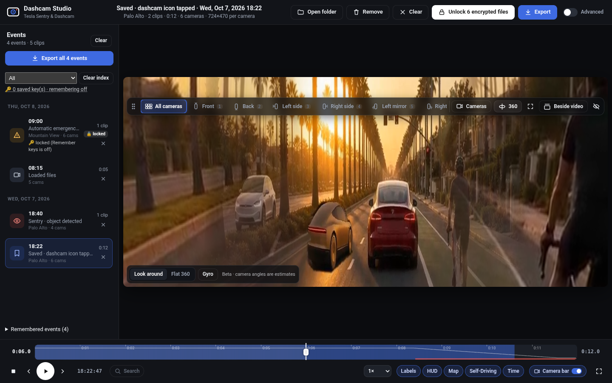
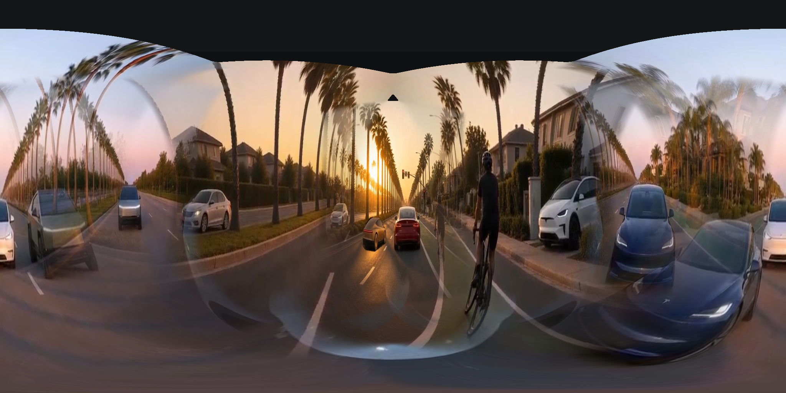

## Keyboard shortcuts
| Key | Action |
|---|---|
| / or Ctrl/Cmd+K | open search (Esc closes it) |
| Space | play / pause |
| ← → | previous / next frame (Shift: ±5 s) |
| 1 – 6 | focus Front, Back, Left side (pillar), Right side (pillar), Left mirror (repeater), Right mirror (repeater) |
| [ / ] | previous / next camera |
| G or Esc | back to the grid |
| + / − | zoom the focused camera (pinch or Ctrl+scroll also work; drag to pan; double-click resets) |
| F | full screen |
| C | camera bar on / off |
| X | detection boxes on / off (same as the **Boxes** button in the camera bar and the *Gold box* checkbox; off = no boxes in the viewer or the export, and Detect while playing pauses) |
| R | redact (blur) search matches on / off (the **Redact** button under the search box; burned into the export too) |
| H · M · D · L | toggle HUD · map · Self-Driving badge · camera labels |

With **Advanced** on: A adds a section, B splits the section at the playhead, I / O set its start / end, S plays only the sections, Delete removes the selected one. On the timeline, Ctrl+scroll or a pinch zooms in, scrolling sideways pans, and double-clicking (or the zoom button) zooms back out.

## Privacy
- **Your footage never leaves your computer** unless you turn on the optional Cloud boost (below). The video files are read and processed locally in your browser. Nothing is uploaded and there's no server or account.
- **Video search** scores frames on this computer. The first search downloads a vision model from Hugging Face (`huggingface.co` and `cdn.jsdelivr.net`). After that the browser keeps the model. The video itself is not sent.
- **Map tiles** come from OpenStreetMap (`tile.openstreetmap.org`), so OSM sees roughly where the map area is. You can turn map tiles off in the app. The route is then drawn on a plain grid.
- **Encrypted clips:** only small key-request records (VIN, key id, wrapped key — never video) go to Tesla's own site, and only when you click *Sign in with Tesla*, run the key helper or use a token you pasted.
- **Library index:** stores file names, sizes, times, camera counts and decrypted/reviewed status in your browser (IndexedDB). Never video, never keys.
- **Plate & text index** (only if you turn on Plates & text): plate numbers and street text read from your footage, with time, camera, box and confidence, in this browser (IndexedDB `tdc-text-index`). Never pictures. **Forget plate & text index** clears it.
- **Cloud boost** (off by default): only when you pick Grok, Claude or Gemini, paste your own key, and confirm the dialog, are downscaled frames or plate crops sent to that one provider's API (billed to you, under their data policy). Your API key stays in this tab unless you tick Remember key.
- **Saved keys:** off by default. Only if you tick **Remember keys on this device** are the 16-byte clip keys stored in this browser (IndexedDB, not encrypted), so anyone using this browser profile could unlock those clips. **Forget saved keys** wipes them, the keys used in the current tab, and clipboard auto-apply, and re-locks open clips. Bearer tokens you paste are kept in memory only and never stored.

## Redact plates, faces, and text
Nothing to install. Open **🔍 Search** (or use the classic **Redact** bar). Type the words to hide, such as a person's name or `Taco Bell, Costco`, and press **Blur text** (**Apply** on the classic bar). Only the text that matches those words is covered. Text is looked for on **every camera** (whatever the camera menu says), the blur follows the text between the frames that were read, and it is an opaque blur sized to the letters, so it works the same in Safari (which has no canvas blur filter) and in the export. Frames that couldn't be read are counted in the status line. See *Search for text (beta)* above for the switch that hides these controls. Other words stay visible. **All text** is the switch that covers every word. Plates and faces are separate buttons. The effect shows on the picture and is included when you export. **Clear** takes it off. The original file on the USB drive is not changed.

The text finder is [PP-OCRv4](https://github.com/PaddlePaddle/PaddleOCR) (Apache-2.0), the same kind of detector as the Python tool's CRAFT model, converted so it runs inside the page. The letter models are already in the folder, so Apply works from a downloaded copy with no internet. The video is not uploaded. Plates are the wide text-shaped regions low in the frame. Faces use the browser's face finder. This does not remove an arbitrary object such as "the yellow truck."

Keep the whole folder together. Opening only `index.html` from outside that folder cannot find the letter models.

The same words also work in [`tools/redact.py`](tools/redact.py) if you want the optional GPU path on a long clip. That path is not required.

It understands:

- `Jane Doe`
- `Taco Bell, Costco`
- `blur the license plate`
- `remove the license plate`
- `blur faces`
- `blur all text`

**Remove** fills the box with the surrounding picture. That works best on a plate or a short bit of text. **Blur** is the safer choice for faces.

### Optional GPU tool
Only if you want a faster pass on a long clip. The website does not need this.

```bash
pip install torch torchvision
pip install -r tools/requirements-redact.txt
```

On an NVIDIA PC, install the CUDA build of PyTorch from [pytorch.org](https://pytorch.org) first, then install the requirements file.

```bash
python3 tools/redact.py "/path/to/front.mp4" "blur the license plate"
```

The new file is `front-redacted.mp4` next to the original. Add `-o` to choose another name. The first text run downloads the CRAFT model. A face request downloads a small face model once.

This does not remove an arbitrary object such as "the yellow truck" or "a person in a hoodie." It only tracks plates, faces, and text.

## Install / use offline, and decrypt speed
- **Fastest way on iPhone:** open `https://shinrajp.github.io/dashcam-studio/` in Safari (https gives the browser crypto, so decrypting is fast), tap Share > Add to Home Screen, then open it once while online. After that it opens like an app and works with no connection. Your footage is never saved by the app, only the app itself and its models (about 57 MB, downloaded in the background).
- Opening the app from `http://<your computer's address>:8770` has no browser crypto, so decrypting uses the built-in slower code (now about 100x faster than before, in background workers, with progress and time left). A one-line note says so, with a **How** button that opens the install steps.
- Details, tests and limits: `CHANGES-v2.md`, section *decrypt-speed*.

## Browser support
- **Chrome or Edge (desktop): best.** You get fast hardware-accelerated export, and *Export all* can save straight into a folder you pick.
- **Safari (Mac):** playback, overlays and trimming work. Export may be slower, and *Export all* saves each video to Downloads one at a time.
- **Safari on iPhone and iPad (iOS 16.4+):** playback, overlays, focus view and trimming work with touch. Export runs in the browser (WebCodecs). When it finishes, tap **Save / Share** to send the video to Photos or Files. Keep the tab in front while it exports, and prefer short sections, because long or *Original* exports can run out of memory on a phone. Older iOS versions fall back to a slower real-time recording, and if a browser can't do either, the export dialog says so. iPhone Safari has no real full-screen mode, so **Full screen** fills the browser window instead. *Export all* saves the videos one at a time.
- Firefox has not been tested.

## Encrypted clips (optional)
Newer Tesla firmware can encrypt dashcam clips. Unencrypted clips need no account at all. Each key request uses the file's own id from the clip header, and decryption happens in your browser.

**How keys are fetched.** Clips are grouped into recording sessions (4 cameras on older cars, 6 with the pillar cameras) and sent to Tesla in batches of at most 30 files, one batch after another, keeping whole sessions together. If Tesla refuses one batch, the others still go through and the app tells you which failed.

### 1. Install the connector (v1.4.4)

**Running Dashcam Studio from another computer on your home network** (e.g. `http://192.168.1.20:8770`, or a `*.local` name)? Connector 1.4.4 trusts these automatically: localhost, 127.x, 10.x, 172.16–31.x, 192.168.x and `*.local`, on http or https and any port. Older connectors answer "Connector refused: player origin … is not in ALLOWED_PLAYER_ORIGINS"; reinstall to fix it. The Tesla sign-in token is still only handed to players on the same computer (localhost); network players only get the per-clip keys.
The connector is a small userscript that runs only on `dashcam.tesla.com` and hands the keys back to Dashcam Studio. Get it from the app's **Unlock** dialog (**Download connector** / **Copy script**) or open [`connector/Tesla-Grid-Player-Connector.user.js`](connector/Tesla-Grid-Player-Connector.user.js) and click **Raw**.

**Chrome or Edge (Tampermonkey)**
1. Install **Tampermonkey**.
2. Open `chrome://extensions` → Tampermonkey → **Details** → turn on **Allow user scripts** (older Chrome: turn on **Developer mode** at the top right). Without this, Tampermonkey silently runs nothing.
3. Install the connector and make sure it's enabled.

**Safari on Mac (Userscripts)**
1. Install the free **Userscripts** app from the Mac App Store and open it once (note its scripts folder, "Change save location").
2. Safari ▸ Settings ▸ Extensions: tick **Userscripts**, then **Edit Websites…** and set `dashcam.tesla.com` to **Allow**. The Userscripts icon should appear in the toolbar.
3. Put `Tesla-Grid-Player-Connector.user.js` in the Userscripts scripts folder (or open it in Safari and use the Userscripts toolbar icon ▸ Install), and switch it on.
4. **Delete older copies.** Connector 1.4.0 and earlier can't run on Tesla's page in Safari. Remove them, and any empty "NewScript-…" script, so only v1.4.4 is left.

**Check it's running:** open `dashcam.tesla.com`. A small blue badge at the bottom left should say **"Dashcam Studio connector v1.4.4 active"**, followed by:
- **not linked**: it's installed; open Tesla from the app's **Sign in with Tesla** button.
- **linked · N clip(s) to unlock**: connected to the app; sign in if asked.
- **Dashcam Studio window link lost**: the sign-in redirect cut the link; when the keys are fetched, click **Copy keys for Dashcam Studio** and switch back to the app.
A red **connector error** badge shows what went wrong.

**iPhone & iPad (no extension needed): the Dashcam Unlock bookmark.** Safari on iOS only runs userscripts through a separate app, so the Unlock dialog on an iPhone or iPad shows its own card with a bookmark that does the same job:
1. **Once:** in the Unlock dialog tap **Copy bookmarklet**. In Safari tap Share ▸ **Add Bookmark** (any page, name it *Dashcam Unlock*), open Bookmarks, touch and hold it ▸ **Edit**, replace the address with the copied code, tap Done.
2. Tap **Sign in with Tesla**. Tesla opens in a new tab; sign in.
3. On that Tesla tab open Safari's Bookmarks (or type *Dashcam Unlock* in the address bar) and tap **Dashcam Unlock**. A panel appears at the bottom and fetches the keys from Tesla's own page.
4. Tap **Copy keys** in the panel, switch back to Dashcam Studio and tap **Paste keys from clipboard**. (If Safari kept the link between the two tabs, the keys also arrive by themselves.)
- If you were already signed in, or the panel says "no clip list": in Dashcam Studio tap **Copy unlock request**, go back to the Tesla tab, tap **Dashcam Unlock** and then **Paste unlock request**. (Sign in with Tesla also puts the request on the clipboard.) Tesla's sign-in can drop the request from the address, so this second tap is sometimes needed.
- Only the keys leave the Tesla page. The bookmark never copies, shows or sends your Tesla sign-in token, and it only posts back to this site, localhost or a home-network address. The unlock request lists key ids, not secrets. Source: [`connector/ios-unlock-bookmarklet.js`](connector/ios-unlock-bookmarklet.js) (about 4.6 KB as a bookmark; `node tools/build-bookmarklet.js` regenerates it, needs `terser`).
- **Alternative:** install the free **Userscripts** app from the App Store, turn it on in Settings ▸ Apps ▸ Safari ▸ Extensions (allow `dashcam.tesla.com`), choose a folder in its app, and save the connector file there from **Download connector** in the dialog. Then Sign in with Tesla works as on the Mac, with the same *Copy keys* fallback.
- Tests: `node test/ios-unlock-bookmarklet.test.js` (bookmarklet logic, mocked Tesla), `node test/ios-unlock.js` (the card at 430×932, iPad and desktop, WebKit + Chromium).

### 2. Unlock
1. Open your folder. Locked events show 🔒, and the top button reads **Unlock N encrypted files**.
2. Click it, then **Sign in with Tesla** (the button shows how many clips are waiting). Sign in on the Tesla page if asked. The keys come back and the clips unlock.

**Other ways, in the same dialog:**
- **Import keys or token (no console needed, works on phones):** choose a keys file, or paste keys JSON or a Bearer token. A token can only be used directly if your browser lets the page call Tesla (often it can't, because of CORS); the app says so and points you to the helper.
- **Manual console method (fallback):** four numbered cards. **Copy key helper** → **Open dashcam.tesla.com** and sign in → open the browser console on that tab (steps for your device: Safari's Develop menu on a Mac, Ctrl+Shift+J on Windows / Linux; **Show steps for another device** switches) and paste the helper, press Enter → paste the printed result into the box. It **applies by itself** when you paste (the **Apply keys** button still works), tolerates console noise (`< ` prefixes, `undefined`, code fences, quotes, log lines) and says in plain English how many clips unlocked ("4 of 4 clips unlocked", or "2 of 4 … 2 still need keys" with their names). iPhone / iPad have no console: the section says so and points to the Dashcam Unlock bookmark. Why a helper (CORS), the pending key requests and a short troubleshooting note are under **Advanced**. The helper snippet and its `{"results":[…]}` output are unchanged. The helper also copies the result, so you can just return to the app: keys on the clipboard are still applied automatically.

### 3. Remember keys (optional)
Tick **Remember keys on this device** in the dialog to store each clip's key in this browser. Next time you open (or re-add) the same clips they unlock automatically, before anything asks Tesla. Each event shows a 🔑 note such as *unlocked with saved keys* or *no saved key match*, and the sidebar shows **🔑 N saved key(s)** (click it to open the key settings). When nothing is locked, the top button stays available as **🔑 Keys (N saved)**. **Forget saved keys** asks first, then forgets everything and re-locks open clips. Saved keys are per browser and per address (`localhost` and `file://` are separate).


### Troubleshooting
- **iPhone: "No connector answered … normal on iPhone":** use the Dashcam Unlock bookmark above (or the Userscripts app). The panel's red messages say what is missing, for example "not signed in" (sign in on the Tesla tab, wait for the page, tap the bookmark again) or "no clip list" (Copy unlock request, then Paste unlock request).
- **"Connector not detected"** after 20 s: there's no badge on the Tesla page, so the script isn't running. Recheck *Allow user scripts* (Chrome) or the Userscripts extension and site permission (Safari), and remove duplicate or old copies.
- **Safari, no badge:** turn on Safari ▸ Settings ▸ Advanced ▸ **Show features for web developers**, then on the Tesla tab choose Develop ▸ **Show JavaScript Console**, reload, and look for lines starting with `[DashcamStudio]`. No `connector 1.4.4 starting` line means Userscripts isn't injecting it.
- **"Connector detected, but no Tesla sign-in token yet":** sign in on the Tesla page, or use its **Paste token** box.
- **"Tesla refused the key request: HTTP …":** your session may have expired, or Tesla changed the endpoint. Sign in again or use the console helper.
- **Sign in with Tesla does nothing:** no clips are waiting. The list was cleared, or every clip already has a key. The message says which.
- **Clips stay locked after Forget:** that's intended. Supply keys again.

Some caveats:
- The Tesla key endpoint is undocumented and may change. The ≤30-files-per-request limit is a cautious guess.
- The connector only hands keys to this site (`https://shinrajp.github.io`) and to copies of the app running on your own computer (`localhost`), or to a local `file://` copy after one confirmation click. A helper you paste yourself can also post keys back to the window that opened the Tesla tab.

## Automatic exports (optional companion helper)
The companion runs in the background on your Mac or PC. Plug in the drive and walk away. It finds new Saved and Sentry events, exports a 1080p MP4 of each with the HUD and map burned in, and notifies you when they're done. It only reads the drive and never writes to it.

1. Download this project: [**Download ZIP**](https://github.com/shinrajp/dashcam-studio/archive/refs/heads/main.zip), then unzip it. Keep the folder together, because the helper uses the app files next to it.
2. Install the requirements:
   - **Mac:** install Homebrew from [brew.sh](https://brew.sh), then run `brew install node ffmpeg`. Google Chrome or Microsoft Edge is recommended for the full graphical HUD.
   - **Windows:** run `winget install OpenJS.NodeJS.LTS Gyan.FFmpeg`.
3. Run the installer:
   - **Mac:** double-click `companion/install-mac.command`. If macOS blocks it, run `bash companion/install-mac.command` in Terminal from the unzipped folder.
   - **Windows:** double-click `companion\install-windows.cmd`.
4. Plug in the Tesla drive. The videos appear in `~/Movies/TeslaCam Exports` on a Mac or `Videos\TeslaCam Exports` on Windows.

Helper commands are run as `node companion/dashcam-companion.js <command>`:
- `doctor` checks your setup.
- `config` changes settings, such as native-resolution export, RecentClips, a cloud share folder or auto-decrypt.
- `uninstall` removes the helper.

The [`companion/`](companion/) folder has the source.

## For developers
- [`PLAN.md`](PLAN.md) describes the architecture. [`CHANGES-v2.md`](CHANGES-v2.md) lists the v2 changes and rollback tags.
- `node test/batching.test.js` runs the batching unit tests. `test/*.js` are headless-Chrome tests (puppeteer-core; serve the folder with `python3 -m http.server`). `test/legacy/` holds the original build-box harness, whose paths need adjusting. `tools/make-samples.py` builds synthetic TeslaCam footage, including encrypted clips.
- After editing `connector/Tesla-Grid-Player-Connector.user.js`, run `node tools/build-connector.js` to refresh the copy the app offers for download.

## Status
This is a working prototype. It has been tested with synthetic TeslaCam footage in Chrome and on an Apple Silicon Mac, but not yet with a wide range of real Tesla footage, real encrypted clips, or on Windows. Feedback and issues are welcome.

Not affiliated with or endorsed by Tesla, Inc. "Tesla" is a trademark of Tesla, Inc.

## occluded-people (branch feature/all-in-one, tag `occluded-people`)
Rollback: `git checkout pre-occluded-people` (tip before this change, `export-panel`).

A person who walks behind a parked car's window, behind a pillar, or far away in the dark is often under the model's cut-off in the full picture, or hidden for a few seconds. This adds a cheap way to look again, and a longer memory for who it was.

- **Motion windows (`js/motion.js`, pure, no model):** every camera picture the viewer already grabs is shrunk to a 96-pixel grey map and compared with the last one (adaptive threshold; a whole-picture change of more than 35 % — headlights, exposure — is ignored). Moving blobs that no person box already covers, and that are not a moving car, become windows. Blobs inside a parked car's glass are marked as glass.
- **Second looks:** the model sees a zoomed, upscaled crop of each window, brightened first (percentile stretch, gamma, glare knee and a light CLAHE-like local contrast; a crop that is already well exposed is left alone). Two scales on computers, one alternating scale on phones. Inside a window the cut-off is 0.18, and a backpack or handbag next to a person-shaped blob counts as a hint (0.25). A seeded track is confirmed only after 3 looks (about 0.4 summed score) **and** a walker-like path (steady speed, mostly sideways, no jitter). The rear-camera legs-fix labelling still applies.
- **Budget (auto-throttled):** phones 1 look per 1.2 s, at most 5 per 10 s, 1 window, 352-pixel crops; computers 1 per 0.5 s, 14 per 10 s, 2 windows, 512-pixel crops. Looks stop when a look would make playback stutter (the speed guard that already protects the normal looks).
- **Hidden person kept:** a tracked person who disappears stays as a ghost for 3.5 s (Settings ▸ Object detection ▸ *Keep a hidden person*: Off, 2, 3.5, 6 s; `?occl=N` seconds, 0–8). A look near where the person would be by now brings the **same** track back (strong looks at once, weak ones need two), so there is no second person. Registry hand-off across cameras uses position, timing, direction, colour histogram and the bundled appearance model as before, plus a forward-heading prior on the same camera. The same-person link state in the car view is unchanged.
- **Still false "people":** a box that never moves, never scores 0.5 and was not found by motion (a headrest seen through a window, a fender) stops counting after 5 s, also when it flickers out and back (`D.STATIC`).
- **Settings:** *Hard-to-see people* = Auto (default: only with Detection speed *Balanced*), Always, Off (`?seed=on|off`, pref `seed`, localStorage `tdc.seed`). *Keep a hidden person* as above. **Model: YOLO11 medium** (computers only, off by default; 80.7 MB, AGPL-3.0 like the other YOLO11 weights, not in the repo and not in the offline pack, see `models/README.md`). **Choose model file…** (`js/model-picker.js`): pick your own `yolo11m.onnx` once per device; it is kept in this browser's IndexedDB (database `tdc-user-models`, outside the service worker caches, so app updates never remove it) and works on any address (GitHub Pages, localhost, a LAN IP). Order: stored file → `models/yolo11m.onnx` next to the app → the `urls.medium` pref. *Remove stored model* clears it; the status line shows what is stored. Nothing is uploaded, and the help text there explains how to export the file. On the real clip it only helped the tiny far figure, and it costs 2–3× more time per look.
- **`?debug=det`:** also draws the motion windows (yellow, glass blue), the second-look windows with each look's scale and score, and the seeded-look count per 10 s.
- **Tests:** `BR=chromium|webkit node test/occluded-people.js` (desktop and phone 430×932 in one run). It draws a dark garage, a parked car with a dark window, a pillar and a walker, and uses a **pixel-based mock** in place of the model: it proves the logic (found with seeding and not without, one identity through the pillar, no tracks on a static headrest, light flashes or noise, the look budget, medium only on computers) and says nothing about how well the real model sees a real person. `tools/clip-eval.js` replays private per-camera frames through the real model, tracker and registry (frames stay outside the repo).
- **Limits (measured on one private screen recording, not the original clip):** the man was physically hidden by the car body for about 5 s (pixels show nothing), so nothing can detect him there; only the identity link across the gap helps. Real-clip gains were modest: 32 of 46 seconds with a person tracked (29 before) and 3 identities (4 before; the target is 1). The two extra identities were still boxes at 0.36–0.41. Seeded looks are slow on a single-thread WASM box (1.4–2.8 s each), so how much they add on an iPhone or Mac is not yet measured.

## Worker start failures explain themselves (worker-fix)
"Detection worker failed: the worker script could not start" used to say nothing about why. Now `js/worker-start.js` keeps the reason the first (blob) start failed and, for a message-less worker error, runs `TDC.workerStart.diagnose()`: the script's HTTP status / type / size and a syntax check, a tiny test worker that reports fetch, IndexedDB, WebAssembly and importScripts, plus browser, secure-context and host. The same text, with a "What to try" line (reload with `?nosw=1`, clear site data, update Safari, content blockers, wait a minute on githack), appears in the status line and the console (`worker diagnostics`). Plates use the same text. Test: `BR=chromium|webkit node test/worker-fix.js`.

## Follow half-hidden people (ByteTrack-style, tag `bytetrack`)
Rollback: `git checkout pre-bytetrack` (tip before this change, `plates-local`, 3a650d4).

A person seen through a van window, behind a pillar or in glare often drops from 0.6 to 0.15 for a moment. The detector used to throw those low boxes away, so the person disappeared and came back as a new number. Now (ByteTrack's idea, adapted to the existing tracker):

- **Two passes.** Strong person boxes (≥ the confidence setting, 35 % default) match the tracks first, exactly as before. Tracks left over then try the **weak** boxes (10 %–35 %) by overlap, or a weak box lying inside the predicted box (a head and shoulders over a roof). A matched track moves only 35 % of the way to the weak box and keeps its id, colour, attributes and hand-off history.
- **Weak boxes never start a person, never show as a detection, and are never counted.** They are handed to the tracker only (`pool`, full frames only, person class only, never crops). NMS and the drawn/exported box set are untouched, so viewer and export still match.
- **Only a track that was once confident can be extended** (it scored ≥ 0.5 at some point, was seen at least twice, and is not a seeded or weak-only track). A still box that never scores 0.5 (a headrest behind glass) is therefore **not** kept alive by weak boxes: the still-box filter and the motion filter work as before.
- **Coast and retire.** A track held only by weak boxes retires after *Keep a hidden person* seconds (3.5 s default) from the last strong look, like a ghost. With *Keep a hidden person* Off the new pass is off too.
- **Same code offline and live.** `D.buildTracks` (the search follow-up `trackAround`) uses the same two passes; the live viewer asks the model for the weak boxes (`msg.pool`, a person-only floor of 0.10), the search path only for person tracking.
- **Settings:** Settings ▸ Advanced recognition ▸ Object detection ▸ *Follow half-hidden people* (default on; `?byte=0|1`, pref `byte`, localStorage `tdc.detect.v1`). Output format of tracks is unchanged, so the people list and the hand-off cue need no change.
- **Test:** `BR=chromium|webkit node test/bytetrack.js` (synthetic mock detector: bridge a gap with the same id, weak boxes never start a track, no extension of a never-confident still box, coast ends, off = old behaviour, rear camera low person at the frame edge, `buildTracks` with and without the pool, and the setting).
- **Real-clip result (one private screen recording, replay through the real YOLO11 models, honest):** small (the clip's earlier reference, 32 of 46 s with someone tracked, 1 id on the man, 3 ids in total) **33 of 46 s, same ids**; nano 36 s, same ids, no change; medium 38 -> 39 s (man 28 -> 30 s), same ids. In the clip the man is physically hidden by the car for about 5 s and the small model has no box above 0.10 there, so a weak box cannot bridge him; the gain is a second or two where the model does give a low box. The first version (without the 0.5-peak rule) kept still headrest boxes alive (nano false-person seconds 6 -> 22, medium 7 -> 11) and was fixed before release. **It does not fix the target of 1 id on the man for that clip**, it only helps when there is a weak box to follow.
- **Not verified:** real Safari / iPhone, other clips, the speed cost on a phone (the worker returns a few extra person boxes per look; not timed).

## Custom regions: hide something the automatic redaction misses (tag `custom-redact`)
Rollback: `git checkout pre-custom-redact` (tip before this change, `bytetrack`, ccc92e7).

Automatic redaction only blurs the plates, faces and text the models find. A plate that is bent by the rear fisheye lens is often missed. **Custom regions** let you draw the spot yourself, once, per camera.

**How to use it**
1. Open **Search** ▸ **Redact**, then open **Custom regions** (at the bottom of that panel).
2. There is no camera menu: you pick the camera on the picture itself (step 6).
3. Choose the **Shape**: **Box**, or **Freehand** for a bent plate (draw round it with a finger or the mouse).
4. Choose **Hide with**: **Blur** (strong, the text cannot be read) or **Remove** (solid black).
5. **When**: it is the **Whole clip** by default. Untick it to type a *From* and *to* time, press **Now** to take the current playhead position, or **Use my sections** to take the span of your trim.
6. Press **Draw region**. With several cameras on screen it says **Tap the camera you want to redact**: tap (or click) that camera, for example the right pillar in the 6-camera view, and it comes up large; drag on it, then **Save region**. With one camera on screen it goes straight to drawing. On a phone the panel steps aside while you draw and a small bar at the bottom holds **Save region / Draw again / Cancel**.
7. The list shows each region with a tick (on/off), **Show** (jump to it), **Edit** and **Delete**.

**What it does**
- The region stays in the same place on the picture (it does not follow a moving car; see future work). It is stored as a fraction of the camera's picture, so it is the same spot at any zoom, in full screen, in a mirrored tile, and in the export.
- **Export burns it in**, in every layout: per-camera ticks, Fill black area / Add panel / Overlay, Match viewer order (mirrored cells included), trimmed and joined sections (only the sections inside the region's time range), and the 360 equirect export. The export dialog says how many regions will be hidden. A region on a camera you did not tick is simply not in the file.
- **Saved in this browser** under a fingerprint of the clip (a hash, no file names, dates or folders). **Save as file / Load from file** writes and reads a small JSON file (`dashcam-studio-regions`), so you can move regions between browsers. Up to 40 regions of up to 96 points each.
- Nothing is uploaded. The blur uses plain canvas drawing (no canvas `filter`), so it works in Safari and on iPhone.

**Limits (honest)**
- Regions do not follow a moving object: if the plate moves across the frame, draw a region for each stretch of time (or one big enough to cover its path). *Follow tracking* is future work.
- The live 360 *look-around* view does not show custom regions (and does not show the automatic redaction either). The 360 **export** does burn them in.
- Not tested on a real iPhone or Safari (headless WebKit only). A phone's speed with several blur regions has not been measured.
- Blur is strong but not a cryptographic guarantee; use **Remove** if the text must never be recoverable.


## Search / Redact window: scrolls and resizes (tag `ui-quick`)
Rollback: `git checkout pre-ui-quick` (tip before this change, `custom-redact`, 1a1d9a1).
- The window now scrolls as a whole, so the **Custom regions** section at the bottom is always reachable, docked under the video, floating, or as the phone sheet. Its header (grip, float, pin, close) stays at the top while you scroll.
- The floating window can be dragged taller than before (the old 620 px cap is gone): it grows up to the screen height, never off the bottom, and is put back inside the screen after a resize or when the browser window shrinks. The docked window is capped just under the screen height with its own scroll.
- On the phone draw bar, **Options** is now a toggle: it opens the Redact panel, and the button becomes **Back to drawing**, which tucks the panel away again so you can see the picture. (A real pop-over of the options inside the bar is planned with the bubble UI.)
- Test: `node test/ui-quick.js` (see test/README.md).

## Draw bar stays out of the way (tag `bar-fix`)
Rollback: `git checkout pre-bar-fix` (tip before this change, `ui-quick`, 10bf875).
- While you draw a custom redaction region, the small bar (**Save region / Draw again / Cancel / Options**) lets your finger or mouse through, so you can draw right where it sits.
- When your stroke gets close to it, the bar hops to the opposite edge of the screen (top or bottom). Drag the **⋮⋮ grip** at its left end to put it anywhere; it remembers the spot until you close the tab.
- The HUD, map, car view and the camera bar's empty parts also stop catching the stroke while you draw.
- Test: `node test/bar-fix.js` (see test/README.md).

## A separate Redact button (tag `redact-button`)
Rollback: `git checkout pre-redact-button` (tip before this change, `bar-fix`, 8a9a176).
- **Redact** is now its own button right beside **Search** (same look, icon plus label; on phones both are small labelled pills over the picture). Both open the same window, which now has two tabs: **Find** (search) and **Redact**. Search opens Find, Redact opens Redact; it remembers the tab for the visit.
- The **Redact** tab holds everything for hiding things: the automatic controls (plates, faces, text, street signs) and **Custom regions**, already open, with a big **Draw region** button at the top. **Find** only searches.
- The window is compact (docked or as the phone sheet it is at most 45% of the screen height and scrolls inside; a floating window can be dragged and resized by its corner). While you draw a region the window steps aside so the whole picture is free and the draw bar shows; **Save region**, **Cancel** or the **Redact** button bring it back.
- Region behaviour, the export and the draw bar are unchanged. Keys: `/` and Ctrl+K open Find; the tabs use Left / Right / Home / End.
- Test: `node test/redact-button.js` (see test/README.md).

## Tap the camera to redact (tag `tap-redact`)
Rollback: `git checkout pre-tap-redact` (tip before this change, `redact-button`, d2ad533).
- The **Camera** dropdown in Custom regions is gone. Press **Draw region** (or the **Redact** tab's big button) and, when several cameras are on screen, the picture says **Tap the camera you want to redact**. Tap or click one (for example the right pillar in the 6-camera view): it comes up large and you draw on it straight away. With one camera on screen it skips the question.
- The draw bar shows which camera you are on (a small chip, for example **Right pillar**); tap the chip to choose another. Keyboard: Tab to a camera and press Enter; Escape cancels.
- Saved regions, the list and the export are unchanged (same storage, same burn-in).
- The bottom bar no longer gets crowded by the Redact button: on narrower desktop windows (below 1200 px) Search and Redact show as icons (with tooltips), the row of toggle chips scrolls sideways with a fade instead of pushing things off screen, the clock hides at 1000-1199 px, messages (toasts) move up or to the side so they never sit on the buttons, the draw bar or the Redact window, and on phones the Redact circle steps aside while the draw bar is up (its **Options** brings the window back).
- Tests: `node test/tap-redact.js`, `node test/bottom-overlap.js` (see test/README.md).

## Floating map, and Calibration follows 360 (tag `map-float`)
Rollback: `git checkout pre-map-float` (tip before this change, glass-sdf v5, 60ce6fa).
- The map can float **outside** the video. Drag its **⋮⋮ grip** (top-left of the map) anywhere in the window; it stays where you leave it, also after a reload, and is pulled back on screen when the window shrinks or the phone rotates. It never sits on the bottom bar, the Search / Redact buttons or the full-screen button.
- To dock it again, drop it on the right edge of the video (a "Release to dock the map" hint shows), press its **Dock** button, or double-tap the grip. Keyboard: Tab to the grip, Enter floats / docks, arrow keys move it (Shift = bigger steps).
- The exported video's map overlay is unchanged (the floating spot is kept separately from the export layout).
- With **Show 360 view (beta)** off (the default), Settings ▸ **Calibration** is hidden too (along with the 360 button and any open 360 calibration view). Turning 360 on brings it back; your calibration values are kept. `?show360=1|0` and Reset all work as before.
- Tests: `node test/map-float.js`; `test/ui-quick.js` and `test/bottom-overlap.js` updated (see test/README.md).

## Liquid Glass: overview, settings and address overrides (tags `ui-glass-1` … `ui-glass-11`)
The controls are frosted glass that floats over the video: a camera **pill** that docks or floats, a **tools bubble** (Redact, Search, Events, Settings), a **Redact tray** with undo, a timeline **capsule**, grouped **Settings**, and glass that takes its tint from the video under it. Nothing in the export changed: an export from before the overhaul (`cee26b8`) and after it is byte-identical for the same clip and settings (checked in ui-glass-10).


| Setting (Settings ▸ Appearance unless noted) | Choices (default in bold) | Address override for one visit |
|---|---|---|
| Glass | **Automatic** (tint follows the video) · Clear · Solid | `?glass=auto` · `?glass=clear` · `?glass=solid` |
| Glass style | **Refraction** (WebGL: the edges bend the video like real glass) · Frosted (blurred glass). Refraction turns to Frosted by itself in Lite mode, with Solid, Reduce transparency, without WebGL, or when playback drops frames | `?refract=1` · `?refract=0` |
| Auto-hide (controls fade while playing) | 2 s · **3 s** · 5 s · Never | `?autohide=2` · `3` · `5` · `never` |
| Lite mode (no blur, no video tint) | **Auto** (turns on for the session if playback stays under ~40 fps for 3 s, or on a low-memory device) · On · Off | `?lite=auto` · `?lite=on` / `?lite=1` · `?lite=off` / `?lite=0` |
| Show 360 view (beta) (Advanced & Labs; also shows Calibration) | On · **Off** | `?show360=1` · `?show360=0` |

- An override wins over the saved choice for that visit only and is not saved (Auto-hide says so in Settings). Settings ▸ Advanced & Labs ▸ Reset all settings clears the saved choices.
- The system's **Reduce transparency** makes the glass solid; **Reduce motion** turns off fades, springs and the moving tint. A browser that can't blur gets the solid look.
- **Accessibility (ui-glass-10):** every control in the bubble, tray, Settings, camera pill and map handles has a name for VoiceOver; on touch each is at least 44 px or has a 44 px hit area (the camera pill's small ⋮⋮ grip is the exception: 30 px, with the 44 px More button beside it); the bubble and tray open with Enter and close with Esc, returning focus; Settings is a labelled dialog.

<details>
<summary>More Liquid Glass screenshots (mock footage)</summary>

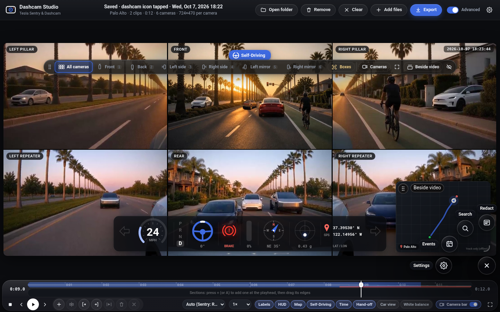
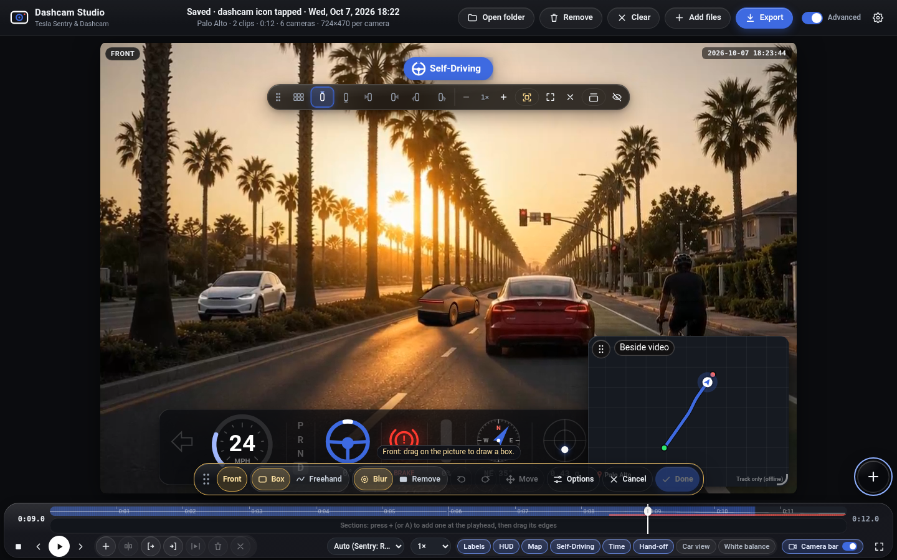
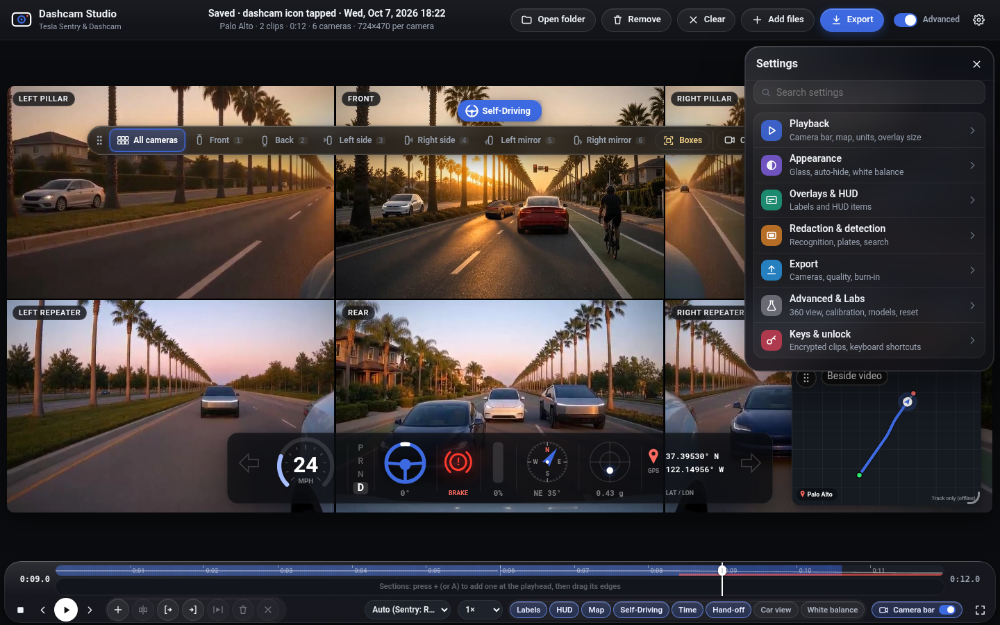
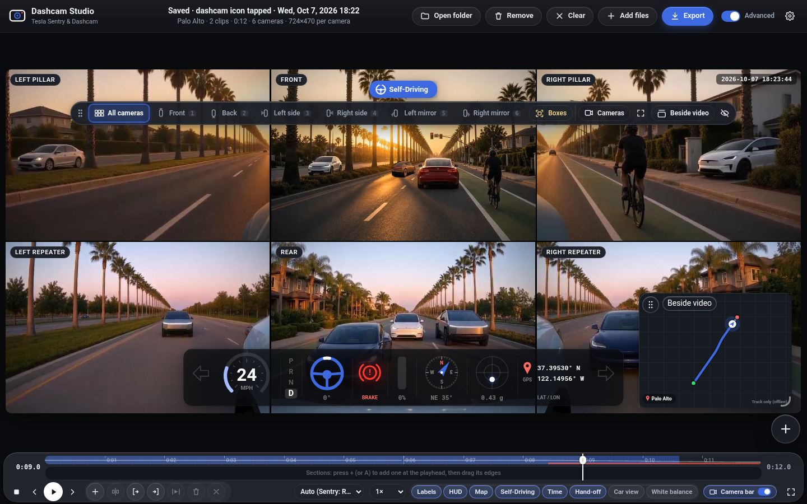
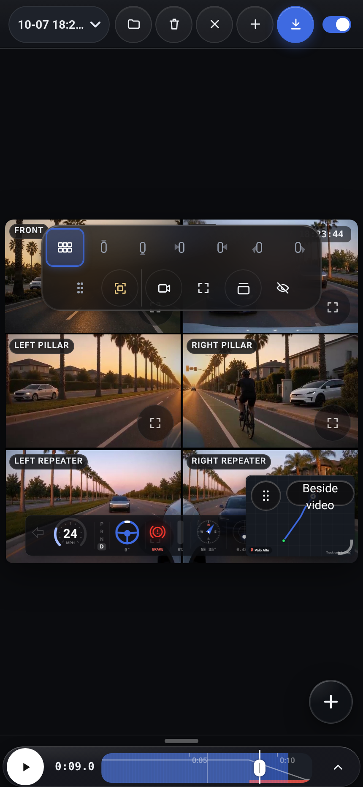
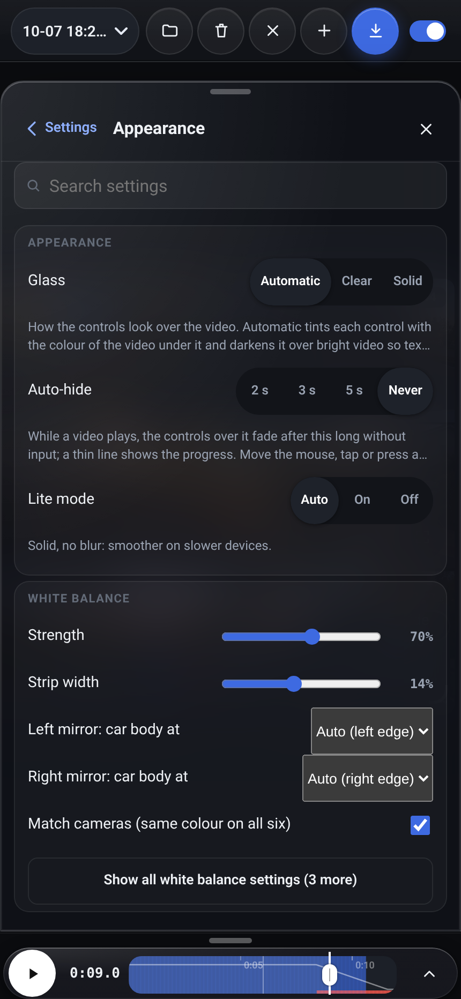
</details>

Screenshots: `python3 tools/make-photo-footage.py tools/mock-stills /tmp/photo-mock`, then `FIX=/tmp/photo-mock node test/glass-shots.js` (Chromium; writes `screenshots/liquid-glass-*.png`). The footage is made from AI-generated stills; no real drive or plates.

Known issues: see CHANGES-v2.md ▸ "Liquid Glass: summary".

## Liquid Glass, step 1: the material (tag `ui-glass-1`)
Rollback: `git checkout pre-ui-glass-1` (tip before this change, `map-float`, 14da42e).
- The controls look like frosted glass: the top bar, the bottom bar and its chips, the camera bar, the Search / Redact window, the draw bar, the map frame, the Settings drawer and the toasts. They have rounded capsule shapes, a thin light edge along the top and a soft shadow. **Nothing moved**: every button is where it was and works the same way.
- **Settings ▸ Appearance ▸ Glass**: **Automatic** (default; the glass gets darker over bright video so white text stays readable), **Clear** (more see-through; text can be harder to read over a bright sky) or **Solid** (no transparency). For one visit, add `?glass=auto`, `?glass=clear` or `?glass=solid` to the address.
- It switches to Solid by itself when your system asks to **Reduce transparency**, or in a browser that can't blur. **Reduce motion** turns the glass pieces' animations off.
- To stay smooth on iPhone, at most three pieces are blurred at once (the rest keep the same tint without blur).
- The exported video is unchanged.
- The SDF/WebGL refraction from `labs/glass-sdf` is not in this step. It is planned for a later step, as the default with this frosted glass as its fallback.
- Tests: `node test/ui-glass-1.js` (see test/README.md).

## Liquid Glass, step 2: controls hide while playing (tag `ui-glass-2`)
Rollback: `git checkout pre-ui-glass-2` (tip before this change, `ui-glass-1`, e3926f2).
- While a video plays, the controls (camera bar, bottom bar with the timeline, Search / Redact buttons, the floated map and the enlarge buttons on each camera) fade out after **3 seconds** without input. A thin blue line at the bottom of the video shows where you are.
- Move the mouse, tap, press a key or move focus to bring them back. On a phone, the tap that brings them back does only that: it doesn't pause, enlarge a camera or press a button.
- They **never hide** while paused, while you hold the mouse or a finger down (seeking, trimming, dragging), while you draw or pick a camera for redaction (the draw bar always stays), while a panel, the bottom sheet, Settings or a dialog is open, while you type in a field, while the mouse is over a control, or during an export.
- **Settings ▸ Appearance ▸ Auto-hide**: 2 s, **3 s** (default), 5 s or Never. For one visit, add `?autohide=never` (or 2, 3, 5) to the address.
- With **Reduce motion** on they switch at once, without fading. Hidden controls don't block taps on the video and don't cost blur.
- The camera bar no longer fades while paused (it used to fade after about 3 s in any state). The exported video is unchanged.
- Tests: `node test/ui-glass-2.js` (see test/README.md).

## Liquid Glass, step 3: timeline and trim capsule (tag `ui-glass-3`)
Rollback: `git checkout pre-ui-glass-3` (tip before this change, `ui-glass-2`, 77f5d39).
- The bottom bar (timeline, play controls, sections and toggles) is now one rounded glass **capsule** that floats on the page colour. On a phone, the slim play row (play, time, timeline, ⌃) is the capsule, and in the pull-up sheet the section buttons (add, split, start, end, play sections, delete, clear) sit in their own small capsule.
- The timeline is drawn with rounded bands: the scrub band, the sections lane, the section blocks, the trim handles and the playhead knob.
- Nothing moved: every button, the timeline and the sections lane keep their exact size and place, so seeking, trimming (drag an edge or the middle of a section), pinch / Ctrl+scroll zoom and the iPhone touch behaviour work as before. Touch targets stay at least 44 px.
- It follows the Glass setting (Automatic / Clear / Solid), Reduce transparency and Reduce motion, hides with the other controls while playing (Auto-hide), and in full screen the blur sits on the capsule only.
- The exported video is unchanged.
- Tests: `node test/ui-glass-3.js` (see test/README.md).

## Liquid Glass, step 4: toggles capsule and eye button (tag `ui-glass-4`)
Rollback: `git checkout pre-ui-glass-4` (tip before this change, `ui-glass-3`, e479950).
- The toggles (Labels, HUD, Map, Self-Driving, Time, Hand-off, Car view, White balance) sit in their own small glass **capsule**: in the controls row on a computer or tablet, and in the pull-up sheet on a phone held upright. They are where they were before and still scroll sideways when the window is narrow.
- iPhone sideways (landscape): there is no room for both, so the slim play bar gets an **eye** button beside ⌃. Tap it and the toggles fan out in a glass popover above the bar; tap a toggle (the popover stays open so you can flip several), then tap the eye again, tap the video or press Esc to fold them back. Opening the sheet closes the popover and the other way round. The toggles are also still in the sheet.
- Every toggle does exactly what it did and is remembered the same way; H, M and D still work. With a keyboard: Tab to the eye, Enter opens it and moves to the first toggle, Esc closes and returns to the eye.
- Touch targets are at least 44 px. It follows the Glass setting (Automatic / Clear / Solid), Reduce transparency and Reduce motion (no fan animation); the controls do not auto-hide while the popover is open.
- The exported video is unchanged.
- Tests: `node test/ui-glass-4.js` (see test/README.md).
## Liquid Glass, step 5: camera pill that docks and floats (tag `ui-glass-5`)
Rollback: `git checkout pre-ui-glass-5` (tip before this change, `ui-glass-4`, 1158342).
- The camera bar is a short glass **pill**. Every camera chip is always visible, so you never scroll it to pick a camera. When room is short the chips lose their names (icons only). On a phone held upright the pill uses two rows, with the cameras on the top row.
- **Float it:** drag the ⋮⋮ grip off the video and the pill floats anywhere in the window, including outside the video, just like the map. A dashed outline shows where it docks. The spot is remembered and the pill stays on screen when the window gets smaller. It never covers the play bar, Search or Redact.
- **Dock it again:** drop it on the dashed spot, double-tap (or double-click) the grip, press the Dock button, or Tab to the grip and press Enter. With a keyboard, Enter or Space on the grip floats it and the arrow keys move it (hold Shift for bigger steps). A pill that was docked beside the video goes back beside it.
- Picking cameras, tap-to-redact camera picking, export and saved settings are unchanged. Touch targets are at least 44 px. A floating pill hides and returns with the other controls under Auto-hide. It follows the Glass setting and Reduce motion.
- On a 390-wide phone, the floated map now moves above or below the camera bar instead of covering it. If you drag the map somewhere yourself, it stays there, and the camera bar is drawn on top of it. Where it cannot fit, as on a phone held sideways, the camera bar stays on top of the map.
- While you draw a redaction box, a camera pill that takes two or more rows fades and lets your strokes through. Float the pill off the video if you want its buttons while drawing.
- The exported video is unchanged.
- Tests: `node test/ui-glass-5.js` (see test/README.md).
## Liquid Glass, step 6: tools bubble (tag `ui-glass-6`)
Rollback: `git checkout pre-ui-glass-6` (tip before this change, `ui-glass-5`, 628fdcd).
- **Tools bubble:** one round glass button at the bottom right holds **Redact, Search, Events and Settings**. Tap it and they fan out with their names; tap one to use it. **Export** stays in the top bar on its own.
- It folds back when you tap it again, press Esc, or tap anywhere else (that tap only closes it). With a keyboard: Tab to it, Enter opens it and moves to the first tool, the arrow keys move between tools, Esc closes it.
- **Move it:** drag the bubble to another corner; it snaps there and remembers it. A click with a mouse or trackpad (Mac Safari too) still just opens it.
- **Events** opens as a glass sheet that slides in from the left; the video uses the full width otherwise. Esc, a tap outside or picking an event closes it. Settings now opens from the bubble in Simple mode too.
- Search, Redact, Events and Settings work as before, with the same shortcuts (/ for Search). Tap-to-redact and the draw bar are unchanged; the bubble steps aside while you draw or pick a region and while a panel is open.
- The controls do not auto-hide while the fan is open; when they hide, the bubble stays as a faint dot. Glass setting, Reduce motion and the blur limit are respected. Targets are at least 44 px.
- **Floating map:** you can now drag it all the way down to the bottom of the window, past the Search / Redact row; its ⋮⋮ grip always stays above the bottom bar so you can pick it up again.
- **Docked Search / Redact panel** (under the video on a laptop or desktop): now a thin strip of one or two lines (about 90 px on a 1024 px window, under 20% of the height). Everything is still there: Draw region, the region options, the automatic chips, the camera and the text to hide sit in the strip; your saved regions open from **Regions (n)** as a short list (Show / Edit / Delete), the help from the small (i), and **⋯** holds Save as file, Load from file and Classic search bars. Esc or a click outside folds these again. The Find tab is a single line.
- **Camera bar:** when the camera buttons are icons only, the small 1–6 numbers are gone so the bar fits on one row more often. The 1–6 keys still work, and hovering (or VoiceOver) still tells you the camera and its key.
- **iPhone event picker:** the event selector in the top bar is a proper 44 px button showing the date and time with a clear ⌄ chevron.
- The exported video is unchanged.
- Tests: `node test/ui-glass-6.js` (see test/README.md).

## Liquid Glass, step 7: Redact tray with undo (tag `ui-glass-7`)
Rollback: `git checkout pre-ui-glass-7` (tip before this change, `ui-glass-6`, a861273).
- **Redact tray:** while you draw a region, the bar over the video is now a small glass tray, like the markup pen tray on an iPhone: the camera, **Box / Freehand**, **Blur / Remove**, **Undo**, **Redo**, **Move**, Draw again, Options, **Cancel** and **Done**. On a phone it shows icons only (two rows when upright); on touch every button is at least 44 px.
- **Undo / Redo:** adding, editing, moving, deleting (and switching off) regions can be undone and redone, with the tray buttons or **⌘Z / ⇧⌘Z** (Ctrl+Z / Ctrl+Shift+Z or Ctrl+Y on Windows). Undo also takes back a shape you just drew but have not saved. The history lasts for the session and the event you are on; it is not saved.
- **Move:** press Move, then drag a saved region to move it, or drag a corner of a box to resize it. The selected region has a yellow outline, corner handles and a tag ("Blur · Box"). With a keyboard, the arrow keys nudge it (Shift: bigger steps) and Delete removes it. Blur / Remove in the tray changes the selected region. Done closes the tray.
- The tray still moves out of the way when you draw near it, can be dragged by its grip (with a mouse or trackpad too, also in Safari), rises in with a small spring (a fade with Reduce motion) and keeps the tools bubble out of the way on phones.
- Saved regions, the regions file and the exported video are unchanged.
- Tests: `node test/ui-glass-7.js` (see test/README.md).

**Camera pill docks when pulled down.** Dragging the camera pill down past the video used to float it as the full labelled one-row strip, stuck over the Rear camera (reported on Mac Safari at about 820 px). Now letting go anywhere on the lower part of the video (or where the pill would cover it) docks it below the video; a dashed strip labelled "Release to dock below the video" shows the spot while you drag, next to the old dock spot. A floating pill is always the compact one (icons only, no 1–6 badges), the same height as docked. The drag no longer uses pointer capture and the release point decides, for Mac Safari. On a short landscape phone the bottom zone docks it back where it came from. Double-click on the grip and the Dock button still dock it. Test: `test/pill-dock.js`.

## Liquid Glass, step 8: grouped Settings (tag `ui-glass-8`)
Rollback: `git checkout pre-ui-glass-8` (tip before this change, `ui-glass-7`, 1831f8d).
- **Settings is now a short glass panel, like Settings on an iPhone.** It opens on a list of groups: **Playback** (camera bar, map, units, overlay size), **Appearance** (glass, auto-hide, white balance), **Overlays & HUD**, **Redaction & detection** (recognition, plates, search), **Export**, **Advanced & Labs** (360 view, calibration, models, reset) and **Keys & unlock** (unlock encrypted clips, keyboard shortcuts). Tap a group to open it; **‹ Settings** goes back. It always reopens on the list.
- **Search settings** at the top finds any setting by a word of its name across all groups (each match shows its group). Esc clears the search, a second Esc closes Settings; Enter jumps to the first match.
- Each group fits on the screen without scrolling on a laptop (1440x900) and a phone (430x932). Overlays and HUD items show in two columns; long sections (white balance) show their first settings and **Show all … settings**; long notes show two lines (click or tap them for the rest).
- On a desktop it is a floating card at the top right; on a phone it slides up as a bottom sheet. With touch every row, button and the search field is at least 44 px and tapping a setting's name flips its switch. The arrow keys move through the groups; it works with VoiceOver (a labelled dialog).
- Every setting, its saved value, its `?glass=` / `?autohide=` / `?show360=` style address override and what it does are unchanged; the × still folds it. **Export…** and **Unlock encrypted clips…** in their groups open the same dialogs as the toolbar buttons.
- Tests: `node test/ui-glass-8.js` (see test/README.md).

## Liquid Glass, step 9: glass that follows the video, and Lite mode (tag `ui-glass-9`)
Rollback: `git checkout pre-ui-glass-9` (tip before this change, `ui-glass-8`, 50f1bc0).
- **Automatic glass now takes its colour from the video under it.** Each control over the video (camera labels, the camera bar, the transport, the map handles, toasts) gets a dark tint of the colour under it and gets more opaque over bright video (sky, snow, headlights) and clearer over dark video, so the text on it always stays at least 4.5:1 against the brightest spot under it. Changes are gradual (darker eases in over about a second, brighter is at once so text never gets hard to read) and a still picture never flickers.
- It is cheap: a tiny copy of the picture (one cell per 16 px) a few times a second while a video plays, refreshing only a few cameras at a time; once after a pause, seek or new clip; nothing with the tab in the background or while exporting. If a device is slow at it, it samples once a second, then only the overall tint. Exports are not affected (the tint is only on screen).
- Reduce motion: one fixed, dark tint. Reduce transparency: solid, as before.
- **Lite mode** (Settings ▸ Appearance ▸ Lite mode: Auto / On / Off) drops all blur and the video tint and uses the solid controls, for smoother playback. **Auto** turns it on for the session when playback keeps running below ~40 frames a second for 3 s (never because of a seek, a resize or a single stall), saying so once, or on a device with little memory. `?lite=on` / `?lite=off` (or `1` / `0`) override it for one visit.
- On touch the Glass, Auto-hide and Lite choices are 44 px targets.
- Tests: `node test/ui-glass-9.js` (see test/README.md).

## Liquid Glass, step 10: tests, accessibility and docs (tag `ui-glass-10`)
Rollback: `git checkout pre-ui-glass-10` (tip before this change, `ui-glass-9`, 1f2d5ca).
- Accessibility pass: Settings controls written as "name + switch" rows now carry the row's name for VoiceOver (overlay size, map tiles, map follow, 360 view, detection and plate confidence, and others). On touch, the white-balance side pickers, the recognition switches and folded notes in Settings are 44 px tall, and the floated map's grip and move handle have 44 px hit areas (nothing moved).
- The export is byte-identical to before the Liquid Glass work (same clip, same settings, three presets).
- The overview above lists every setting and address override; new mock-footage screenshots.
- Tests: `node test/ui-glass-10.js` (accessibility), `node test/glass-shots.js` (screenshots); `test/ui-glass-1.js` and `test/ui-glass-5.js` timing fixes (see test/README.md).


## Liquid Glass, step 11: refraction glass (tag `ui-glass-11`)
Rollback: `git checkout pre-ui-glass-11` (tip before this change, `ui-glass-10`, 5827c76). To switch it off without code: Settings ▸ Appearance ▸ Glass style ▸ Frosted, or `?refract=0`.
- The bubble, its tray, the camera pill, the timeline capsule (phone: the play-bar row), the Events sheet and Settings are drawn as refracting glass (`js/refract.js`, `css/refract.css`): one shared WebGL canvas, drawn only when something changes or while playing, paused when the tab is hidden or an export runs.
- Text stays ≥ 4.5:1: the tint follows the video and is only as strong as the brightest spot under the text needs; over dark video the glass stays clear.
- Frosted glass (unchanged) is the fallback: Lite mode, Solid, Reduce transparency, no WebGL, dropped frames (for the session), the setting or `?refract=0`.
- The export is unchanged (byte-identical). The old frosted UI is still there as the fallback.
- Tests: `node test/ui-glass-11.js` (see test/README.md).