# Tesla Dashcam Studio

### ▶ Use it now: **https://shinrajp.github.io/dashcam-studio/**

A Tesla dashcam and Sentry viewer that runs entirely in your browser. Drop in your TeslaCam folder and get:

- **6-camera grid.** Front, rear, both pillars and both repeaters play in sync in a labelled 3×2 grid, with multi-clip events joined into one timeline.
- **Telemetry HUD.** A draggable graphic HUD with speed, gear, steering wheel, brake, accelerator, blinking turn signals, compass, g-force and GPS. It needs clips with Tesla's embedded telemetry, which arrived in firmware 2025.44.25+ on HW3 and newer.
- **Route map.** A map with the route and a dot that moves with playback. Click the map to seek. **Beside video** parks it next to the picture so it doesn't cover a camera. Drag the corner to resize. Export still burns the map onto the video.
- **One search box.** Tap **🔍 Search** (or press `/` or Ctrl/Cmd+K) to find a moment or hide text from one floating box. It stays an icon until you need it, so it doesn't cover the video. On phones it opens as a bottom sheet above the keyboard.
- **Find in the video.** Describe what you see, for example "a person in a hoodie and a mask." Matches are marked on the timeline. Click one to jump there, or turn them into sections. Frames stay on this computer. The first search downloads a vision model once (about 150 MB). Hits are guesses, not proof.
- **Redact in the window.** Type a name or other words, such as `Jane Doe` or `Taco Bell, Costco`. Only those words are covered. **All text** covers every word. Nothing to install.
- **Self-Driving badge.** It shows Self-Driving, Autosteer or TACC status.
- **Toggles.** Every overlay can be switched on or off, and your choices are saved.
- **Focus & full screen.** Click or tap any camera to enlarge it, switch angles from the camera bar or with keys 1–6, zoom in up to 4× (pinch, Ctrl+scroll or +/−) and drag to pan. You can also hide cameras in the grid and go full screen. The camera bar can be dragged anywhere on the video (grab ⋮⋮; double-click it to put it back), fades when idle, and can be switched off with the **Camera bar** switch or **C**. A small camera button brings it back.
- **Multi-section trim** (turn on **Advanced**). The timeline runs the full width of the window, with a scrub band on top and a tall section lane underneath. Mark several sections, drag their wide edge handles to trim them, drag the middle to move one, or split a section at the playhead. Pinch or Ctrl+scroll zooms the timeline so short cuts are easy to fine-tune. Then play or export the sections joined into one video. The clock and telemetry stay correct at every cut.
- **Export.** *Most Compatible* gives you a 1080p H.264 MP4. *Original* stitches the grid at native camera resolution, pixel for pixel with no upscaling. Overlays are burned into the video.
- **Big libraries.** A saved library index remembers every event you've opened (metadata only, never video), with **All / Undecrypted only / Already decrypted** filters, a reviewed checkbox and **Clear index**.
- **Encrypted clips, the easy way.** **Sign in with Tesla** fetches keys through a small connector userscript (Chrome + Tampermonkey, Safari + Userscripts), in session-aware batches of up to 30 files. You can also import a keys file or paste keys / a Bearer token, and the console helper always works as a fallback. Optional **Remember keys on this device** re-unlocks clips automatically next time.
- **iPhone & iPad.** Touch-sized controls, a 2×3 grid on a phone held upright, and Save / Share to Photos or Files after an export.

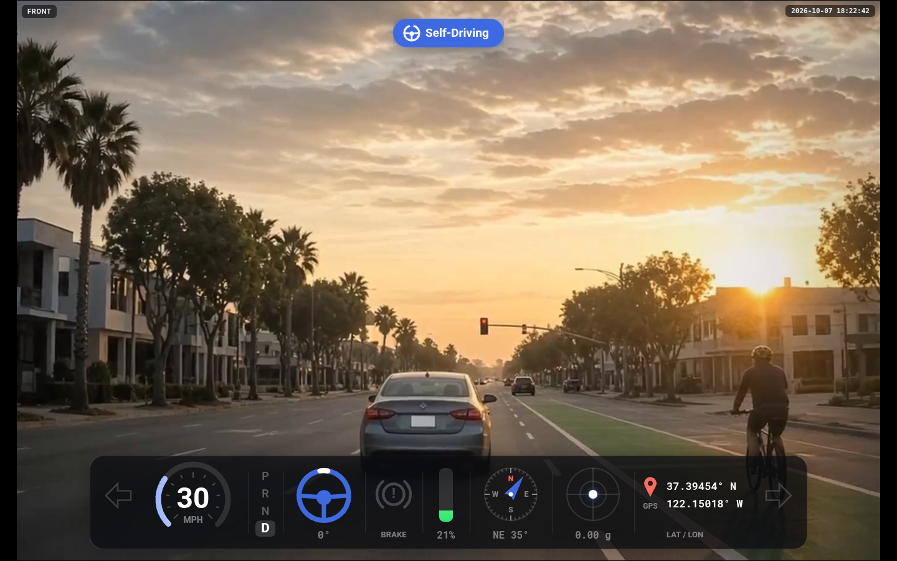

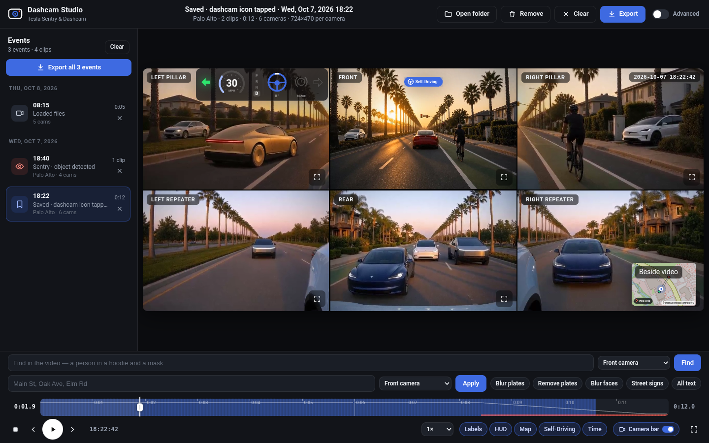

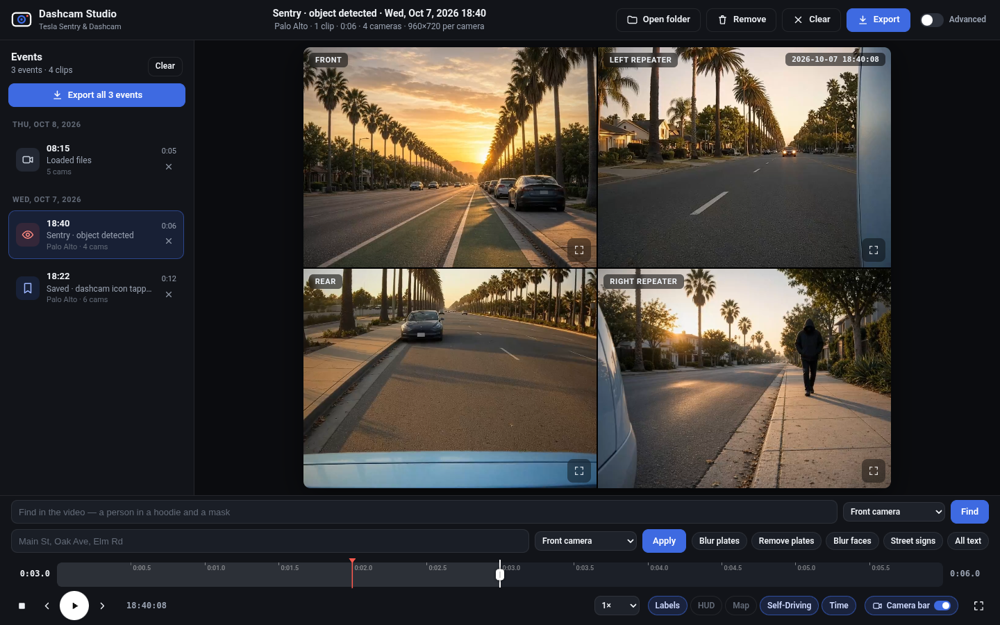

<details>
<summary>More screenshots</summary>

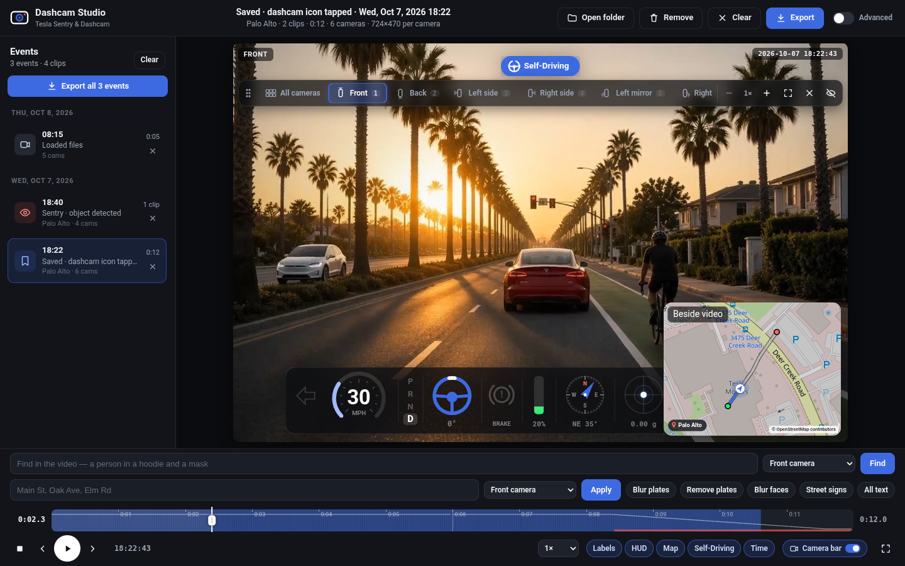

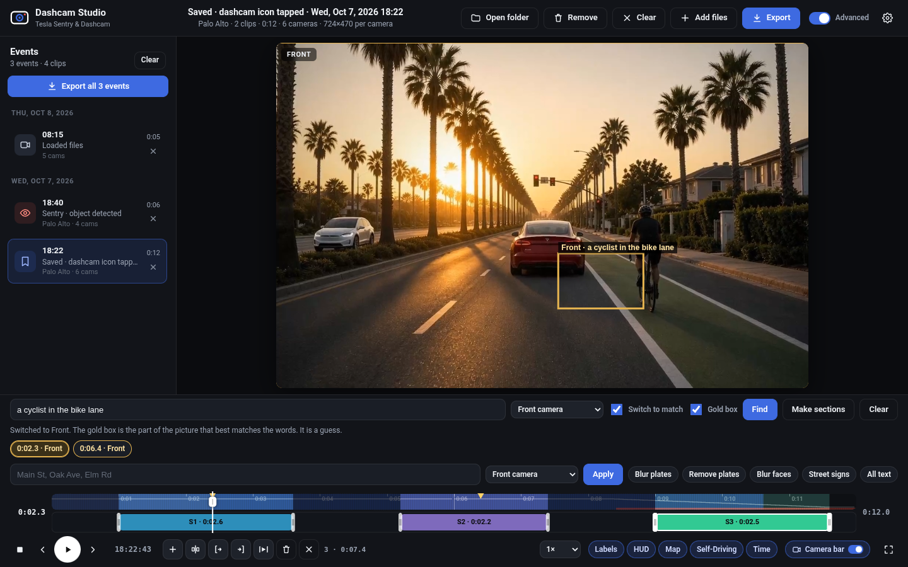
*Find in the video: type what you're looking for. Matches show as chips and yellow marks on the timeline.*

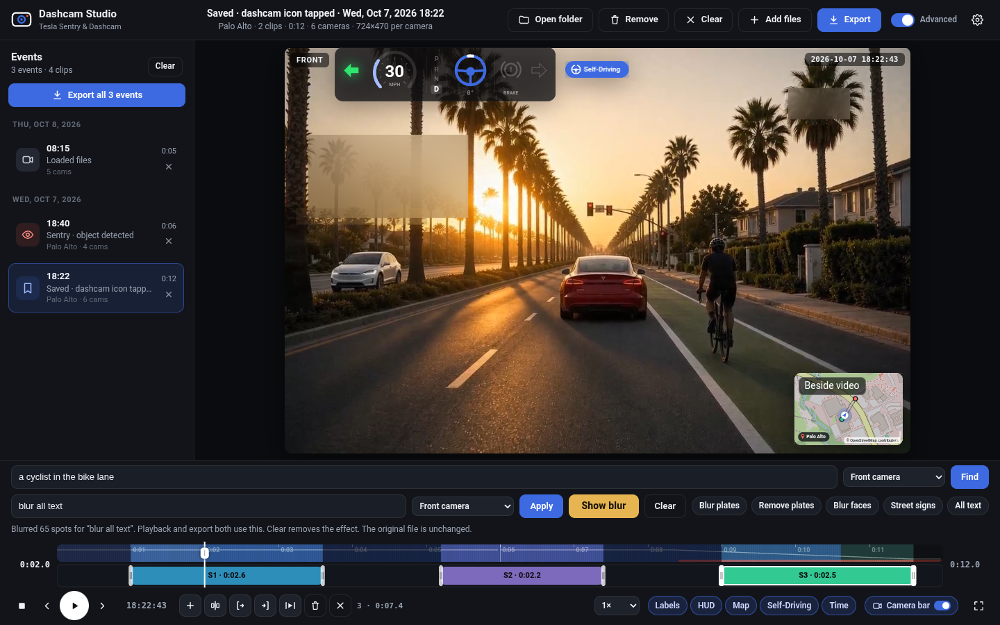
*Redact: one click blurs text, plates or faces on the picture. Export uses the same blur.*

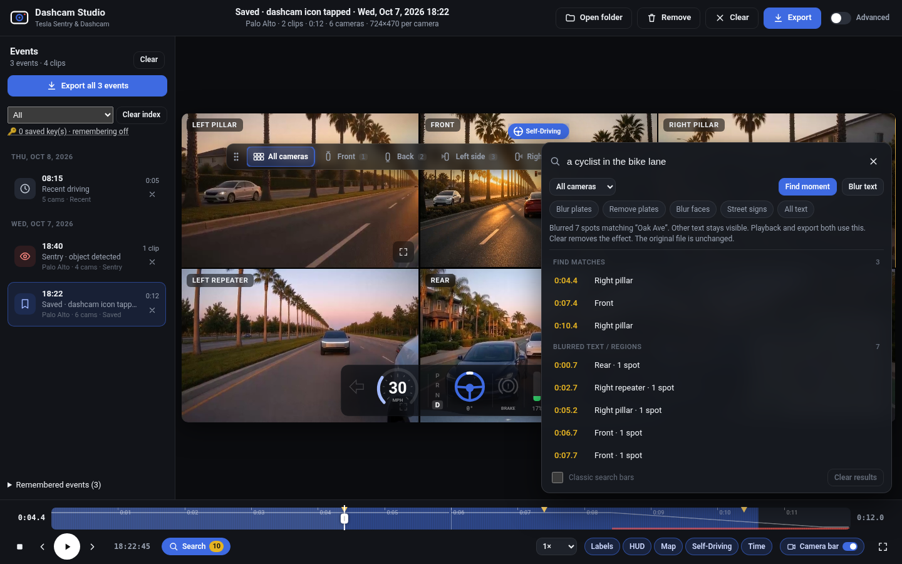
*One search box (new): Find matches and blurred text regions in one list. Click a row to jump there.*

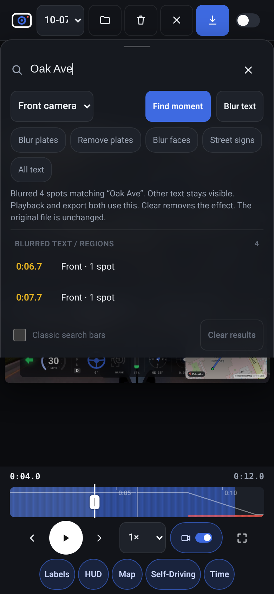
*On a phone the search is a bottom sheet above the keyboard. The video underneath doesn't move.*

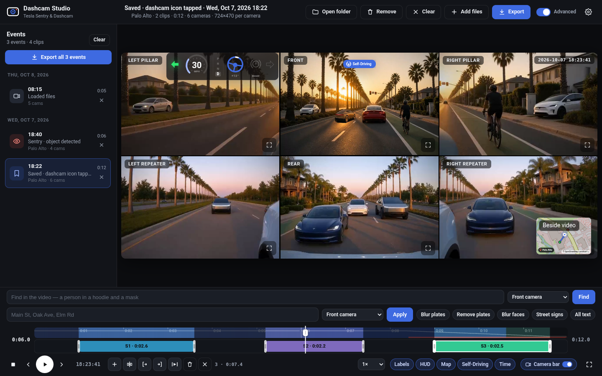

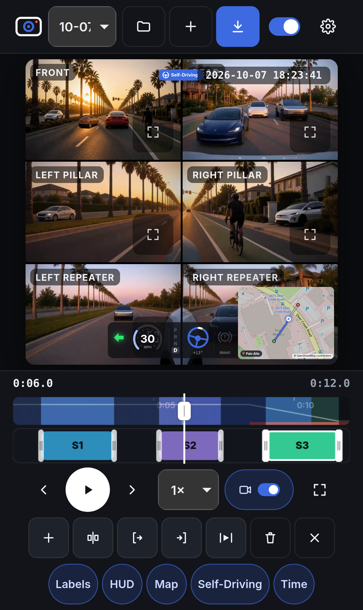

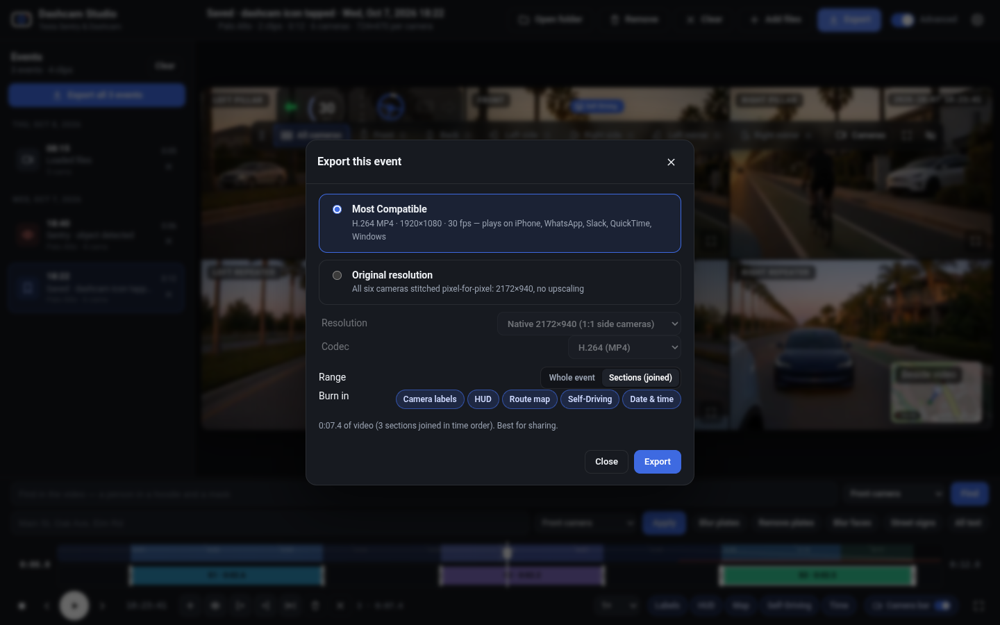

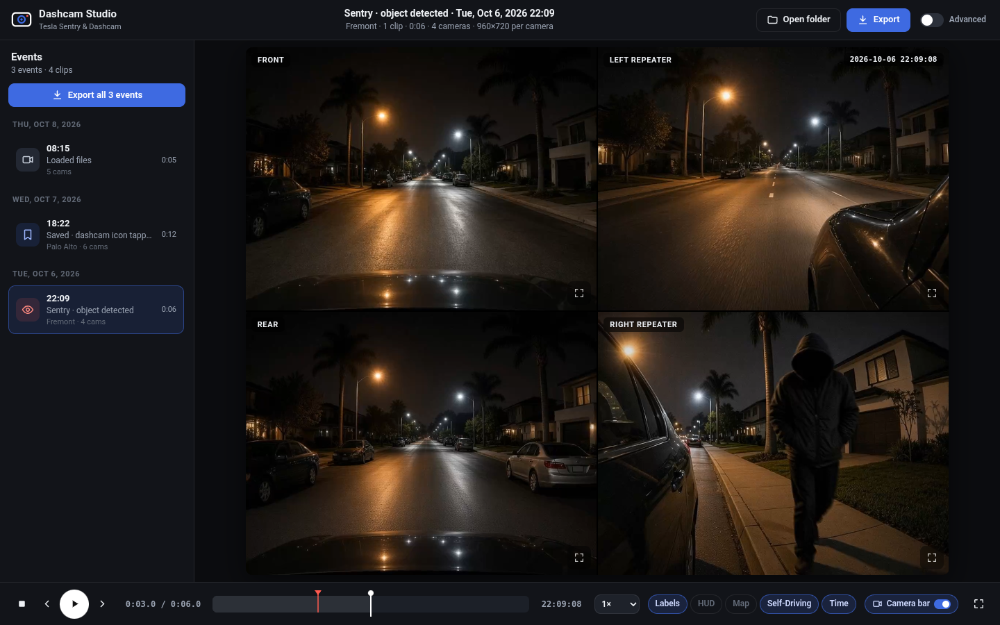

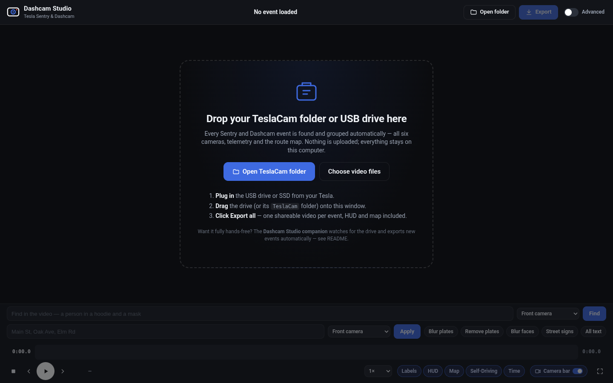

</details>

<sub>Sample footage is AI-generated mock-up imagery: a made-up street, no real dashcam video, people or plates.</sub>

## How to use
1. Plug your Tesla USB drive into your computer, or copy its `TeslaCam` folder somewhere.
2. Open the [app](https://shinrajp.github.io/dashcam-studio/). Then either drag the `TeslaCam` folder onto the window or click **Open folder**.
3. Pick an event on the left and press play, or click **Export all** to make one MP4 per event.
4. **Remove** drops one event from the list. **Clear** drops all of them. Neither deletes files on the USB drive. Open the folder again to bring them back.
5. The **library index** in the sidebar remembers events you've opened before, even after you close the browser. Use the filter (**All**, **Undecrypted only**, **Already decrypted**) to find what's left to unlock, and tick **reviewed** as you go. Remembered events show as "not loaded" until you open their folder again (browsers can't reopen a folder by themselves). **Clear index** forgets the list; it does not delete files and does not remove saved keys. If the browser blocks storage, the app still works and simply doesn't remember between visits.

**On iPhone or iPad:** copy the clips into the Files app first, for example from the USB drive with a USB-C adapter. Then tap **Add files** and select the `.mp4` files (and `event.json` if there is one). The app groups them into events by the timestamps in their file names. Safari can't open a whole folder, so pick the files themselves. Use Files rather than the Photos picker, which may convert the videos.

## Search (Find + Redact in one box)
Tap **🔍 Search** next to the clock (on a phone, the round 🔍 button above the controls), or press **/** or **Ctrl+K / Cmd+K**. Type, then:
- **Find moment** (Enter) looks for a scene or object, such as "a cyclist in the bike lane".
- **Blur text** (Shift+Enter) hides those words wherever they appear. The chips (**Blur plates**, **Blur faces**, **Street signs**, **All text**) work as before.

Results drop down in two groups, **Find matches** and **Blurred text / regions**, each with its time. Click or tap one to jump there: a Find match switches to that camera and draws the gold box, and a text region focuses its camera and flashes a gold outline around it. **Esc** closes the box (a second Esc leaves the focused camera as before). The 🔍 button shows how many results there are.

On phones and narrow windows the box is a bottom sheet pinned above the on-screen keyboard. The video grid isn't resized while you type.

**Classic search bars:** Settings ▸ Search ▸ *Classic search bars* (or the checkbox at the bottom of the search box) brings back the original Find and Redact bars under the video. You can also open the app with `?search=classic`. If the new search ever fails to start, the classic bars appear on their own.

## Keyboard shortcuts
| Key | Action |
|---|---|
| / or Ctrl/Cmd+K | open search (Esc closes it) |
| Space | play / pause |
| ← → | previous / next frame (Shift: ±5 s) |
| 1 – 6 | focus Front, Back, Left side (pillar), Right side (pillar), Left mirror (repeater), Right mirror (repeater) |
| [ / ] | previous / next camera |
| G or Esc | back to the grid |
| + / − | zoom the focused camera (pinch or Ctrl+scroll also work; drag to pan; double-click resets) |
| F | full screen |
| C | camera bar on / off |
| H · M · D · L | toggle HUD · map · Self-Driving badge · camera labels |

With **Advanced** on: A adds a section, B splits the section at the playhead, I / O set its start / end, S plays only the sections, Delete removes the selected one. On the timeline, Ctrl+scroll or a pinch zooms in, scrolling sideways pans, and double-clicking (or the zoom button) zooms back out.

## Privacy
- **Your footage never leaves your computer.** The video files are read and processed locally in your browser. Nothing is uploaded and there's no server or account.
- **Video search** scores frames on this computer. The first search downloads a vision model from Hugging Face (`huggingface.co` and `cdn.jsdelivr.net`). After that the browser keeps the model. The video itself is not sent.
- **Map tiles** come from OpenStreetMap (`tile.openstreetmap.org`), so OSM sees roughly where the map area is. You can turn map tiles off in the app. The route is then drawn on a plain grid.
- **Encrypted clips:** only small key-request records (VIN, key id, wrapped key — never video) go to Tesla's own site, and only when you click *Sign in with Tesla*, run the key helper or use a token you pasted.
- **Library index:** stores file names, sizes, times, camera counts and decrypted/reviewed status in your browser (IndexedDB). Never video, never keys.
- **Saved keys:** off by default. Only if you tick **Remember keys on this device** are the 16-byte clip keys stored in this browser (IndexedDB, not encrypted), so anyone using this browser profile could unlock those clips. **Forget saved keys** wipes them, the keys used in the current tab, and clipboard auto-apply, and re-locks open clips. Bearer tokens you paste are kept in memory only and never stored.

## Redact plates, faces, and text
Nothing to install. Open **🔍 Search** (or use the classic **Redact** bar). Type the words to hide, such as a person's name or `Taco Bell, Costco`, and press **Blur text** (**Apply** on the classic bar). Only the text that matches those words is covered. Other words stay visible. **All text** is the switch that covers every word. Plates and faces are separate buttons. The effect shows on the picture and is included when you export. **Clear** takes it off. The original file on the USB drive is not changed.

The text finder is [PP-OCRv4](https://github.com/PaddlePaddle/PaddleOCR) (Apache-2.0), the same kind of detector as the Python tool's CRAFT model, converted so it runs inside the page. The letter models are already in the folder, so Apply works from a downloaded copy with no internet. The video is not uploaded. Plates are the wide text-shaped regions low in the frame. Faces use the browser's face finder. This does not remove an arbitrary object such as "the yellow truck."

Keep the whole folder together. Opening only `index.html` from outside that folder cannot find the letter models.

The same words also work in [`tools/redact.py`](tools/redact.py) if you want the optional GPU path on a long clip. That path is not required.

It understands:

- `Jane Doe`
- `Taco Bell, Costco`
- `blur the license plate`
- `remove the license plate`
- `blur faces`
- `blur all text`

**Remove** fills the box with the surrounding picture. That works best on a plate or a short bit of text. **Blur** is the safer choice for faces.

### Optional GPU tool
Only if you want a faster pass on a long clip. The website does not need this.

```bash
pip install torch torchvision
pip install -r tools/requirements-redact.txt
```

On an NVIDIA PC, install the CUDA build of PyTorch from [pytorch.org](https://pytorch.org) first, then install the requirements file.

```bash
python3 tools/redact.py "/path/to/front.mp4" "blur the license plate"
```

The new file is `front-redacted.mp4` next to the original. Add `-o` to choose another name. The first text run downloads the CRAFT model. A face request downloads a small face model once.

This does not remove an arbitrary object such as "the yellow truck" or "a person in a hoodie." It only tracks plates, faces, and text.

## Browser support
- **Chrome or Edge (desktop): best.** You get fast hardware-accelerated export, and *Export all* can save straight into a folder you pick.
- **Safari (Mac):** playback, overlays and trimming work. Export may be slower, and *Export all* saves each video to Downloads one at a time.
- **Safari on iPhone and iPad (iOS 16.4+):** playback, overlays, focus view and trimming work with touch. Export runs in the browser (WebCodecs). When it finishes, tap **Save / Share** to send the video to Photos or Files. Keep the tab in front while it exports, and prefer short sections, because long or *Original* exports can run out of memory on a phone. Older iOS versions fall back to a slower real-time recording, and if a browser can't do either, the export dialog says so. iPhone Safari has no real full-screen mode, so **Full screen** fills the browser window instead. *Export all* saves the videos one at a time.
- Firefox has not been tested.

## Encrypted clips (optional)
Newer Tesla firmware can encrypt dashcam clips. Unencrypted clips need no account at all. Each key request uses the file's own id from the clip header, and decryption happens in your browser.

**How keys are fetched.** Clips are grouped into recording sessions (4 cameras on older cars, 6 with the pillar cameras) and sent to Tesla in batches of at most 30 files, one batch after another, keeping whole sessions together. If Tesla refuses one batch, the others still go through and the app tells you which failed.

### 1. Install the connector (v1.4.3)
The connector is a small userscript that runs only on `dashcam.tesla.com` and hands the keys back to Dashcam Studio. Get it from the app's **Unlock** dialog (**Download connector** / **Copy script**) or open [`connector/Tesla-Grid-Player-Connector.user.js`](connector/Tesla-Grid-Player-Connector.user.js) and click **Raw**.

**Chrome or Edge (Tampermonkey)**
1. Install **Tampermonkey**.
2. Open `chrome://extensions` → Tampermonkey → **Details** → turn on **Allow user scripts** (older Chrome: turn on **Developer mode** at the top right). Without this, Tampermonkey silently runs nothing.
3. Install the connector and make sure it's enabled.

**Safari on Mac (Userscripts)**
1. Install the free **Userscripts** app from the Mac App Store and open it once (note its scripts folder, "Change save location").
2. Safari ▸ Settings ▸ Extensions: tick **Userscripts**, then **Edit Websites…** and set `dashcam.tesla.com` to **Allow**. The Userscripts icon should appear in the toolbar.
3. Put `Tesla-Grid-Player-Connector.user.js` in the Userscripts scripts folder (or open it in Safari and use the Userscripts toolbar icon ▸ Install), and switch it on.
4. **Delete older copies.** Connector 1.4.0 and earlier can't run on Tesla's page in Safari. Remove them, and any empty "NewScript-…" script, so only v1.4.3 is left.

**Check it's running:** open `dashcam.tesla.com`. A small blue badge at the bottom left should say **"Dashcam Studio connector v1.4.3 active"**, followed by:
- **not linked**: it's installed; open Tesla from the app's **Sign in with Tesla** button.
- **linked · N clip(s) to unlock**: connected to the app; sign in if asked.
- **Dashcam Studio window link lost**: the sign-in redirect cut the link; when the keys are fetched, click **Copy keys for Dashcam Studio** and switch back to the app.
A red **connector error** badge shows what went wrong.

### 2. Unlock
1. Open your folder. Locked events show 🔒, and the top button reads **Unlock N encrypted files**.
2. Click it, then **Sign in with Tesla** (the button shows how many clips are waiting). Sign in on the Tesla page if asked. The keys come back and the clips unlock.

**Other ways, in the same dialog:**
- **Import keys or token (no console needed, works on phones):** choose a keys file, or paste keys JSON or a Bearer token. A token can only be used directly if your browser lets the page call Tesla (often it can't, because of CORS); the app says so and points you to the helper.
- **Manual console method (fallback):** **Copy key helper**, open `dashcam.tesla.com`, sign in, open the browser console, paste and press Enter. It fetches the keys in batches, sends them back to the app when the app opened that tab, and copies a clean JSON. Paste it into **Paste keys**, or just return to the app: keys on the clipboard are applied automatically.

### 3. Remember keys (optional)
Tick **Remember keys on this device** in the dialog to store each clip's key in this browser. Next time you open (or re-add) the same clips they unlock automatically, before anything asks Tesla. Each event shows a 🔑 note such as *unlocked with saved keys* or *no saved key match*, and the sidebar shows **🔑 N saved key(s)** (click it to open the key settings). When nothing is locked, the top button stays available as **🔑 Keys (N saved)**. **Forget saved keys** asks first, then forgets everything and re-locks open clips. Saved keys are per browser and per address (`localhost` and `file://` are separate).

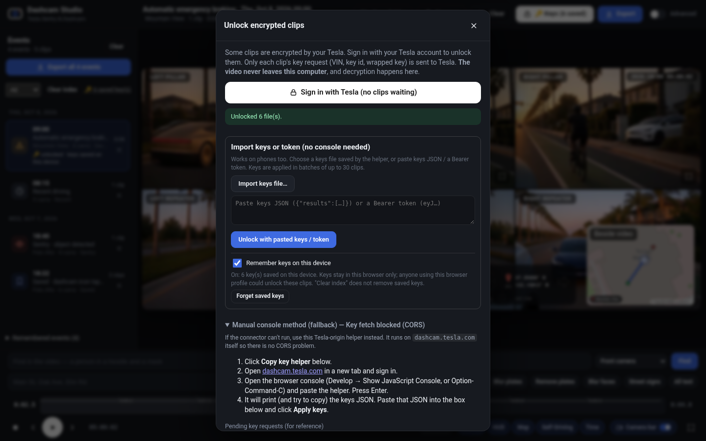

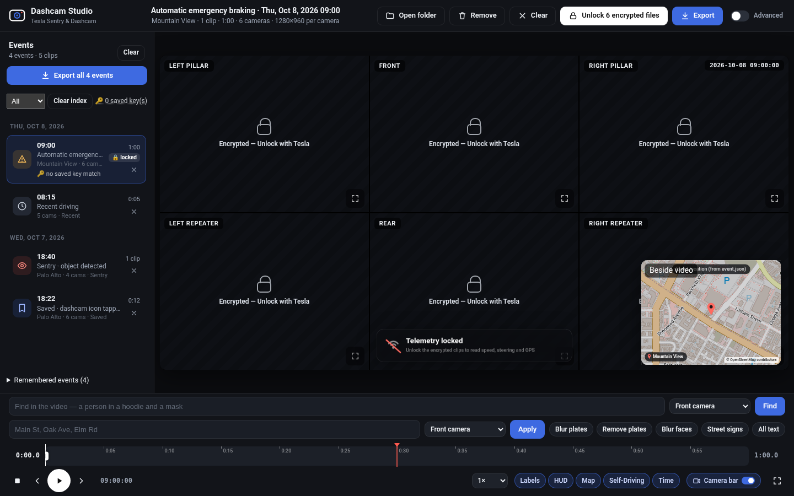

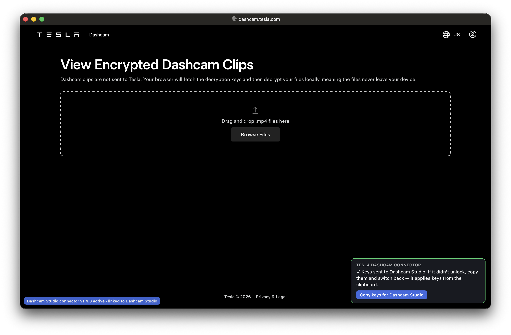

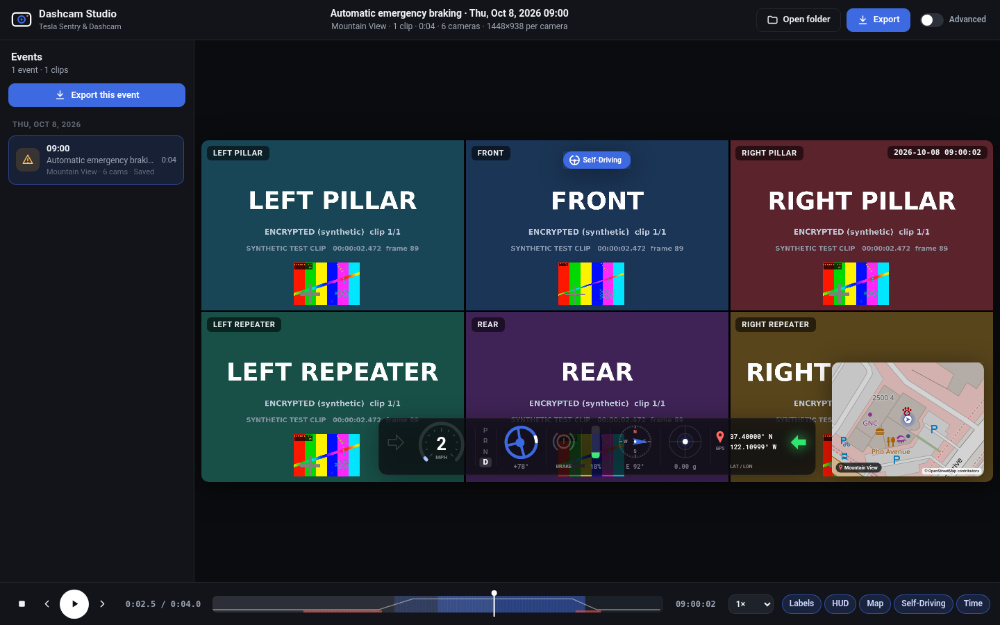

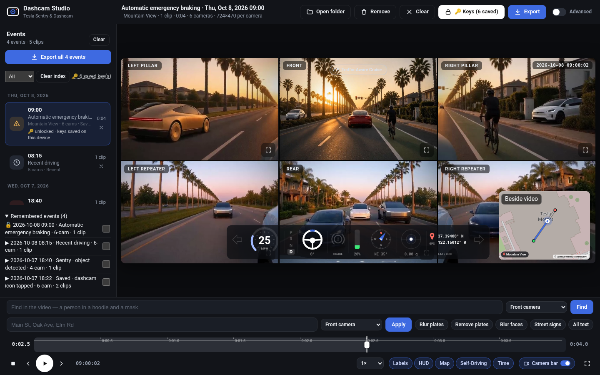

### Troubleshooting
- **"Connector not detected"** after 20 s: there's no badge on the Tesla page, so the script isn't running. Recheck *Allow user scripts* (Chrome) or the Userscripts extension and site permission (Safari), and remove duplicate or old copies.
- **Safari, no badge:** turn on Safari ▸ Settings ▸ Advanced ▸ **Show features for web developers**, then on the Tesla tab choose Develop ▸ **Show JavaScript Console**, reload, and look for lines starting with `[DashcamStudio]`. No `connector 1.4.3 starting` line means Userscripts isn't injecting it.
- **"Connector detected, but no Tesla sign-in token yet":** sign in on the Tesla page, or use its **Paste token** box.
- **"Tesla refused the key request: HTTP …":** your session may have expired, or Tesla changed the endpoint. Sign in again or use the console helper.
- **Sign in with Tesla does nothing:** no clips are waiting. The list was cleared, or every clip already has a key. The message says which.
- **Clips stay locked after Forget:** that's intended. Supply keys again.

Some caveats:
- The Tesla key endpoint is undocumented and may change. The ≤30-files-per-request limit is a cautious guess.
- The connector only hands keys to this site (`https://shinrajp.github.io`) and to copies of the app running on your own computer (`localhost`), or to a local `file://` copy after one confirmation click. A helper you paste yourself can also post keys back to the window that opened the Tesla tab.

## Automatic exports (optional companion helper)
The companion runs in the background on your Mac or PC. Plug in the drive and walk away. It finds new Saved and Sentry events, exports a 1080p MP4 of each with the HUD and map burned in, and notifies you when they're done. It only reads the drive and never writes to it.

1. Download this project: [**Download ZIP**](https://github.com/shinrajp/dashcam-studio/archive/refs/heads/main.zip), then unzip it. Keep the folder together, because the helper uses the app files next to it.
2. Install the requirements:
   - **Mac:** install Homebrew from [brew.sh](https://brew.sh), then run `brew install node ffmpeg`. Google Chrome or Microsoft Edge is recommended for the full graphical HUD.
   - **Windows:** run `winget install OpenJS.NodeJS.LTS Gyan.FFmpeg`.
3. Run the installer:
   - **Mac:** double-click `companion/install-mac.command`. If macOS blocks it, run `bash companion/install-mac.command` in Terminal from the unzipped folder.
   - **Windows:** double-click `companion\install-windows.cmd`.
4. Plug in the Tesla drive. The videos appear in `~/Movies/TeslaCam Exports` on a Mac or `Videos\TeslaCam Exports` on Windows.

Helper commands are run as `node companion/dashcam-companion.js <command>`:
- `doctor` checks your setup.
- `config` changes settings, such as native-resolution export, RecentClips, a cloud share folder or auto-decrypt.
- `uninstall` removes the helper.

The [`companion/`](companion/) folder has the source.

## For developers
- [`PLAN.md`](PLAN.md) describes the architecture. [`CHANGES-v2.md`](CHANGES-v2.md) lists the v2 changes and rollback tags.
- `node test/batching.test.js` runs the batching unit tests. `test/*.js` are headless-Chrome tests (puppeteer-core; serve the folder with `python3 -m http.server`). `test/legacy/` holds the original build-box harness, whose paths need adjusting. `tools/make-samples.py` builds synthetic TeslaCam footage, including encrypted clips.
- After editing `connector/Tesla-Grid-Player-Connector.user.js`, run `node tools/build-connector.js` to refresh the copy the app offers for download.

## Status
This is a working prototype. It has been tested with synthetic TeslaCam footage in Chrome and on an Apple Silicon Mac, but not yet with a wide range of real Tesla footage, real encrypted clips, or on Windows. Feedback and issues are welcome.

Not affiliated with or endorsed by Tesla, Inc. "Tesla" is a trademark of Tesla, Inc.
